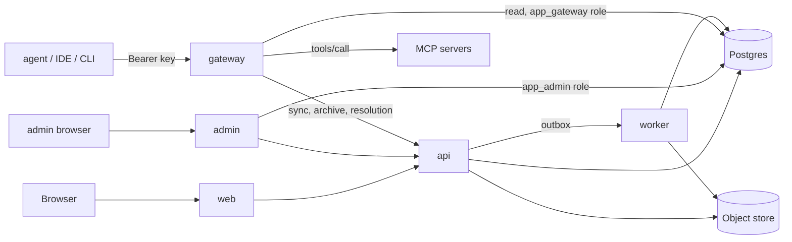

# Architecture overview

One monorepo, one release train, five deployables split by trust boundary and scaling shape (never by feature). Each has its own app folder, entrypoint, config schema, tsconfig and image target (`Dockerfile --target <app>`). Each validates only its own environment and fails closed on missing or weak secrets. There are no mode flags selecting roles.

| Service   | Exposure                                           | Holds                                                 | Scales on           |
| --------- | -------------------------------------------------- | ----------------------------------------------------- | ------------------- |
| `web`     | Public                                             | Session secrets; React client                         | Requests            |
| `admin`   | Public host, IP-restricted, password sign-in       | Admin session secrets, DB (`app_admin`); React client | Rarely              |
| `api`     | Internal (reached by `web`, `admin` and `gateway`) | DB, org keys (seal and unwrap), S3 read-only          | Requests, downloads |
| `gateway` | Public `/mcp` plus forwarded sync and archive      | Redis, cache, KMS unwrap, DB read (`app_gateway`)     | In-flight, loop lag |
| `worker`  | None                                               | DB, queue, email, S3 write, KMS wrap (org keys)       | Queue depth         |

## Data flow

- `api` owns management-time work with untrusted upstreams (probe, tool discovery, OAuth discovery, registration, code exchange) through the SSRF-guarded fetcher. `gateway` only calls tools. `worker` never unwraps keys; untrusted archives are ingested there.
- Agents use one host: `gateway` serves `POST /mcp` and `POST /{server}/mcp` itself and forwards `GET /v1/sync`, `GET /v1/sync/components/{sha256}`, `POST /v1/sync/reports` and `GET /v1/plugin-versions/{id}/archive` to `api` with its own workload identity. Archives are streamed, never buffered, never presigned.
- `admin` also reads Postgres directly with its own role (`app_admin`), and `gateway` reads it with `app_gateway` (a temporary arrangement until the gateway moves to a cache). Each service uses its own database role; `api` uses `app_api`, `worker` `app_worker`.
- Admin routes are served by the `admin` app itself (session cookie plus CSRF); the `/internal/v1/admin` mirror on `api` is not confirmed in the code.
- Internal calls use workload identity (shared secret only in `local` and `test`). Internal credentials never go to an upstream.
- Gateway hot path: versioned cache (pod-local plus Redis) with event invalidation. Key authentication currently reads Postgres on every gateway request; a short key cache is planned (S2.3).

## Projects, three planes and one resolver

A host product is a `project` inside an organization. Its server holds a project key (`prk_`, path `/v1/project/...`); each of its users gets a session token (`stk_`, paths `/v1/sync...`, `/v1/session/...` and the MCP URL); people manage the project in the console (`/v1/orgs/{orgId}/projects/{projectId}/...`). The credential names the scope, so a path never repeats it.

The work splits into three planes: the catalog (plugins, versions, components), control (organizations, projects, users, keys, auth configs, installs, sessions, tool policies, webhooks) and data (gateway, sync, component download). One function, `resolveDelivery` in `packages/domain/src/delivery/`, returns the effective installs and tool policy for a principal, and sync, component download and the gateway call it and nothing else. Every state change writes one audit event, and logs, usage and webhooks all read from it, so they cannot disagree.

## Layout and dependency direction

`apps/<name>/src` is the server entrypoint; `web` and `admin` add `client/` (`web` keeps its server in `apps/web/server`). Direction, enforced by lint: apps → domain → ports; adapters → ports; nothing imports upward. Packages publish `dist` by default and source under the `development` export condition; images run compiled output.

## Packages

One row per package folder under `packages/`; a package without a row fails `scripts/checks/package-disposition.test.ts`.

| Package         | Role                                                                                                                                                  |
| --------------- | ----------------------------------------------------------------------------------------------------------------------------------------------------- |
| `adapters`      | One folder per adapter (subpath exports): `redis`, `s3`, `kms`, `mailpit`, `smtp`, `ses`, `secrets`, `postgres-queue`, `system`, `contract`           |
| `config`        | Shared config helpers; each app owns its config schema                                                                                                |
| `contracts`     | Zod contracts, route and error registries (`v1/`), OpenAPI generator                                                                                  |
| `credentials`   | HPKE sealing and unsealing, org key handling                                                                                                          |
| `db`            | Drizzle schema, generated migrations, roles, row-level security, outbox                                                                               |
| `domain`        | Use-cases by context: identity, tenancy, project, marketplace, ingestion, installation, mcp, credentials, access, delivery, audit, admin, permissions |
| `http-server`   | Shared Fastify bootstrap: middleware order, limits, health, shutdown, idempotency                                                                     |
| `limits`        | Plans, quotas, budgets and defaults as data                                                                                                           |
| `observability` | Logger, metrics, tracing, redaction                                                                                                                   |
| `ports`         | Interfaces only (`cache`, `queue`, `lock`, `blob`, `email`, `limiter`, `clock`, `kms`, `secrets`) plus the `CacheKey` helper                          |
| `sdk`           | Client for hosts: projects, users, sessions and plugin sync                                                                                           |
| `security`      | Passwords (Argon2id), tokens, SSRF guard, workload identity                                                                                           |

`packages/sdk-dotnet` is the .NET twin of `sdk` (a solution, not a pnpm package); both read the shared fixtures in `packages/sdk/fixtures`. Release: [sdk-release.md](../guides/sdk-release.md).

Adding a package or app: `package.json` with `types`/`development`/`default` exports, `build` and `typecheck` scripts and `catalog:` versions; `tsconfig.json` with `composite` plus entry in root `tsconfig.json`; a row in `scripts/checks/architecture.rules.ts`; coverage and Stryker globs; a row above.

## Middleware order (every HTTP service, fixed)

A failure skips the stages up to audit and error mapper.

| #   | Stage                                                                              | Failure                                |
| --- | ---------------------------------------------------------------------------------- | -------------------------------------- |
| 1   | request id, trusted-proxy client address (`TRUSTED_PROXY_CIDRS`)                   | none                                   |
| 2   | size and time limits (`BODY_LIMIT_BYTES`, `MAX_HEADER_BYTES`, timeouts)            | `413`, `431`                           |
| 3   | origin and host (`ALLOWED_HOSTS`; non-GET `Origin` equals `APP_BASE_URL`)          | `403`                                  |
| 4   | IP throttle (`limiter` port; limiter failure lets the request through and warns)   | `429` + `Retry-After`                  |
| 5   | parse and validate (JSON only; Zod params, query, body, headers)                   | `415`, `400`, `404` for a malformed id |
| 6   | authenticate (internal apps verify workload identity first)                        | `401`                                  |
| 7   | authorize (`authorize()` in `domain`)                                              | `403`                                  |
| 8   | idempotency (routes whose registry entry is not `none`; keyed on principal)        | `409`                                  |
| 9   | handler                                                                            | any `AppError`                         |
| 10  | audit (once per request; never changes the response)                               | none                                   |
| 11  | error mapper (`AppError` to registered status; anything else `500 internal_error`) | none                                   |

Outside the order: security headers on every response, access log and metrics, `GET /healthz`. Shutdown has two bounds: `SHUTDOWN_PREDRAIN_SECONDS` then `SHUTDOWN_DRAIN_SECONDS`; a second signal exits 1. In tests a response that does not match its registered schema is a server error.

## Ids

`<prefix>_<32 hex>` (row uuid without dashes), converted only at the API boundary; a malformed id in a path answers `404`. Prefixes: `usr` user, `org`, `inv` invitation, `ses` session, `plg` plugin, `pv` plugin version, `cmp` component, `ins` installation, `key` API key, `okey` org key, `evt` audit event, `src` plugin source, `job`, `cat` category, `mcs` MCP server, `tol` tool, `ksw` kill switch. API key tokens are `<keyId>.<secret>` with `keyId` = `fyk_`, `plk_`, `prk_` or `stk_` plus 16 hex characters, not ids.

## Deployment

One image per service from the root `Dockerfile` (or `docker/<service>.Dockerfile`); all services ship together with one tag. Kubernetes on GKE (manifests in `k8s/`), Cloud SQL (Postgres), Secret Manager and Cloud KMS; the repository contains no infrastructure-as-code. See [guides/deployment.md](../guides/deployment.md) and [guides/operations.md](../guides/operations.md).
