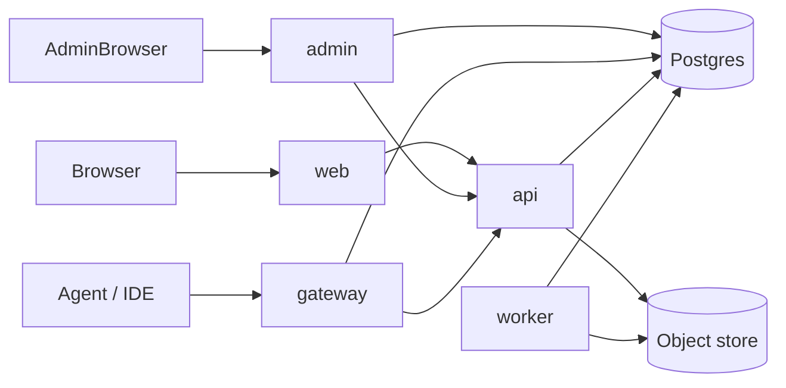

# Deployment and pipelines

Short reference for how the five services are built, pipelined and deployed. Configuration variables and runtime behaviour: [operations.md](operations.md). Local run against shared staging: [run-with-staging-secrets.md](run-with-staging-secrets.md).

## Topology

| Service   | Code                                    | Port          | Exposure                      | Talks to                           |
| --------- | --------------------------------------- | ------------- | ----------------------------- | ---------------------------------- |
| `web`     | `apps/web/server` and `apps/web/client` | 3000          | Public (HTTPS load balancer)  | `api`                              |
| `admin`   | `apps/admin`                            | 3004          | Public, IP-restricted (HTTPS) | `api`, Postgres                    |
| `api`     | `apps/api`                              | 3001          | Internal only (ClusterIP)     | Postgres, KMS, Redis, object store |
| `gateway` | `apps/gateway`                          | 3002          | Public `/mcp` (HTTPS)         | `api`, Postgres, Redis             |
| `worker`  | `apps/worker`                           | 3005 (health) | None                          | Postgres, KMS, object store, email |



- Edge traffic ends at the Google Cloud load balancer with Google-managed TLS certificates for `web`, `admin` and `gateway`.
- Services reach each other through cluster DNS (`http://<api-service>.<namespace>.svc.cluster.local:3001`). A `NetworkPolicy` lets only `web`, `admin` and `gateway` reach `api`; the application also authenticates every internal caller.
- `admin` and `gateway` also read Postgres directly, each with its own database role (`app_admin`, `app_gateway`); `api` uses `app_api` and `worker` uses `app_worker`.
- There is no separate verifier service; sealing and key checks live in the `credentials` and `domain` packages.

## Images

- Build from the repository root, because services share `packages/*`. Use the root `Dockerfile` with `--target <service>`, or `docker/<service>.Dockerfile`.
- Names: `boldcreate-<env>-integrations-<service>` in Google Artifact Registry (`<env>` is `staging`, `preproduction` or `production`).
- Node 24 and pnpm 10 are pinned in the Dockerfiles; keep them equal to `.azure/ci.yml`.

```sh
for target in api gateway worker web admin; do
  docker build --target "$target" -t "$REGISTRY/boldcreate-$ENV-integrations-$target:$TAG" .
  docker push "$REGISTRY/boldcreate-$ENV-integrations-$target:$TAG"
done
```

## Pipelines (Azure DevOps)

**CI** (`.azure/ci.yml`) runs on pushes to `development`, `feature/*` and `fix/*` and on pull requests into `development`:

| Stage        | Runs                                                                                                              |
| ------------ | ----------------------------------------------------------------------------------------------------------------- |
| Verify       | `pnpm install --frozen-lockfile`, migrations are append-only (PRs), then `pnpm test`; publishes `test-run-report` |
| SecurityScan | `pnpm audit --audit-level=high` and the secret scan                                                               |

**Release**: one pipeline per service, not stored in this repository. Each one is the same three steps; only the service name, the path filter (`apps/<service>/**`, `packages/**`, its Dockerfile, `pnpm-lock.yaml`) and the manifest folder change:

```yaml
steps:
  - task: Docker@2 # build and push
    inputs:
      command: buildAndPush
      containerRegistry: GCP-Artifact-Registry-Connection
      repository: codestudio-dev/synccodestudio/boldcreate-staging-integrations-api
      dockerfile: $(Build.SourcesDirectory)/docker/api.Dockerfile
      buildContext: $(Build.SourcesDirectory)
      tags: $(Build.BuildId)
  - task: qetza.replacetokens.replacetokens-task.replacetokens@6 # puts the build id into the manifest
    inputs: { sources: k8s/api/staging/deployment.yaml, tokenPattern: rm }
  - task: Kubernetes@1 # apply to GKE
    inputs:
      connectionType: Kubernetes Service Connection
      kubernetesServiceEndpoint: gke-cluster-connection
      namespace: boldcreate-stag
      command: apply
      arguments: -f k8s/api/staging/
```

Manifests carry the image tag as `#{Build.BuildId}#`; the token step replaces it before `apply`.

## Kubernetes manifests (`k8s/`)

- Layout: `k8s/<service>/<environment>/`. Files: `deployment.yaml`, `config-map.yaml` for all; `service.yaml` except `worker`; `ingress.yaml` and `backend-config.yaml` for `web`, `admin`, `gateway`; `network-policy.yaml` for `api` and `worker`.
- Environments: `staging` (namespace `boldcreate-stag`), `preproduction`, `production`. Secrets are not in the repository.
- Hardening: non-root user 1000, read-only root filesystem, no service account token, `/healthz` and `/readyz` probes (the worker serves its probe on 3005).
- Production rollout: `web`, `admin`, `api`, `gateway` run 2 replicas with `maxSurge: 1` and `maxUnavailable: 0`; the worker runs 1.

## First deployment to a new environment

1. Enable the GCP APIs (GKE, Artifact Registry, Cloud SQL, Compute); create an Artifact Registry Docker repository, a GKE cluster, and a PostgreSQL 16 Cloud SQL instance.
2. Build and push the five images (above).
3. Create Google-managed certificates for the app, admin and MCP hostnames.
4. Create the namespace. Migrations are not run on the cluster; `pnpm db:migrate` is for local development and tests. Apply schema changes to a cluster database by hand, expand first and contract later, so the previous release keeps working.
5. Apply the manifests in this order: `api`, `worker`, then `web`, `admin`, `gateway`.
6. Read the load balancer addresses (`kubectl get ingress -n <namespace>`) and point the DNS records for the three hostnames at them.

Later releases skip steps 1, 3 and 6: migrate, then roll out the services.
