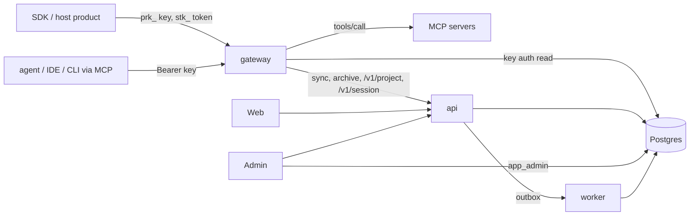

# Capacity, queueing and connection pooling

Status: proposal, for review. The pooler, the durable write queue and the new limits are one-way-door changes and need an entry in `docs/architecture/decisions.md` before rollout. Work items and their status are in section 14. Nothing here is verified on staging unless it says so.

## 1. In one minute

- We have **one Postgres** (1 vCPU, 3.75 GB) that is **not** autoscaled, and **many pods** that are (api, gateway, worker, admin, web).
- Every pod opens its own database connections. More pods means more connections, but the database can only do a few things at once. When the role's connection limit is hit, Postgres refuses new logins immediately, and users see errors.
- The fix has two parts: **cap the work that reaches the database** (a connection pooler and queues), and **refuse extra work quickly and politely** (503/429 with `Retry-After`) instead of failing slowly. Writes that must not be lost go through a durable queue.
- No design serves unlimited users on one database. The promise we can keep: **no request fails because of connection exhaustion; every request is served, queued for a short bounded time, or refused fast with a retry hint; accepted writes are never lost.**

## 2. Words used in this document

| Term               | Meaning                                                                                                                 |
| ------------------ | ----------------------------------------------------------------------------------------------------------------------- |
| Pod                | One running copy of a service. GCP adds and removes pods automatically.                                                 |
| Connection pool    | A set of open database connections a pod reuses. Setting: `DB_POOL_MAX`.                                                |
| Role               | A database login (`app_api`, `app_gateway`, `app_worker`, `app_admin`). Each has a hard `CONNECTION LIMIT`.             |
| Pooler (PgBouncer) | A small proxy between pods and Postgres. Thousands of pods connect to it; it uses only a few real database connections. |
| Transaction mode   | The pooler lends a database connection for one transaction only, then gives it to someone else.                         |
| Queue              | Requests wait their turn instead of failing. Always bounded in size and time.                                           |
| Backpressure       | Telling callers "slow down" (429/503 plus `Retry-After`) when we are full.                                              |
| Load shedding      | A pod refusing new work early, cheaply, when its own CPU, memory or event loop is overloaded.                           |
| Idempotency key    | A caller-supplied id that makes a repeated write return the first result, so retries are safe.                          |
| p95                | 95% of requests are faster than this time.                                                                              |

## 3. What happened (root causes)

| #   | Symptom                                                 | Cause                                                                                                                                                                                                            |
| --- | ------------------------------------------------------- | ---------------------------------------------------------------------------------------------------------------------------------------------------------------------------------------------------------------- |
| 1   | `too many connections for role "app_api"` (503)         | Each api pod holds `DB_POOL_MAX` (8 in staging) plus 2 for observability. The role allows 40 by default. Under a spike, restarts and overlapping pods, the role was full and Postgres refused at once (`53300`). |
| 2   | `timeout exceeded when trying to connect` (503)         | The pod's own pool was full, and callers waited `DB_POOL_WAIT_SECONDS` (5 s) and gave up.                                                                                                                        |
| 3   | `relation "limit_setting" does not exist`               | `k8s/migration-staging-job.yaml` and the production job stopped at migration `0005`, so `0006` never ran on staging. Unrelated to load, but it logs an error on every limits refresh.                            |
| 4   | Locust: 888 of 2000 requests failed, up to 70 s latency | Same saturation. The test client retried `429` but treated `503` as a hard failure, so failed users came straight back and made it worse.                                                                        |

What the Locust run measured (`reports/load-locust`, 200 users): no errors only up to about 16 req/s, and already with seconds of latency. Failures began near 25 req/s. At the 85 req/s plateau about 58% of responses were 503, which are fast refusals, not served requests. So 85 is **not** capacity.

**Planning rate for this database: 20 to 40 req/s sustained.** This is an estimate (not measured on a healthy system). Replace it with the number from section 12.

## 4. How traffic reaches the database

Gateway and api carry most traffic because SDK calls and MCP are routed through them. What that means for load:

| Service | Database role / pool today        | What drives load                                                                                              | Notes                                                                                                                             |
| ------- | --------------------------------- | ------------------------------------------------------------------------------------------------------------- | --------------------------------------------------------------------------------------------------------------------------------- |
| gateway | `app_gateway`, pool 10 (+2 obs)   | Every SDK and MCP request. Key authentication reads Postgres on every request today (a key cache is planned). | Forwards sync, archive and project/session routes to api, so one gateway request can cost a gateway read plus an api transaction. |
| api     | `app_api`, pool 8 in staging (+2) | Project routes, sync, sessions, users, management.                                                            | Has a project-key cache (30 s). Reads and writes.                                                                                 |
| worker  | `app_worker`, pool 5              | Outbox jobs, idempotency purge, observability retention.                                                      | Background; must never starve live traffic.                                                                                       |
| admin   | `app_admin`, pool 5               | Admin screens, usage and observability reads (up to 92 days).                                                 | Reads the database directly.                                                                                                      |
| web     | none                              | Calls api.                                                                                                    | Scales with users, adds load on api only.                                                                                         |

MCP calls are special: `POST /mcp` and `POST /{server}/mcp` run a tool on an upstream server for **30 s by default and up to 120 s** (`DEFAULT_CALL_TIMEOUT_MS`, `MAX_CALL_TIMEOUT_MS`). That request is open a long time while using almost no database. It must be counted separately from short database requests (section 7).

## 5. Target design (the layers)

Each layer protects the next one. Every layer is described once here; values are in section 6.

| #   | Layer                         | What it does                                                                                                                                                                              | Needs a decision? |
| --- | ----------------------------- | ----------------------------------------------------------------------------------------------------------------------------------------------------------------------------------------- | ----------------- |
| L1  | Edge limits                   | GCP load balancer or Cloud Armor rate limit, `IP_THROTTLE_LIMIT` (0 = off today), per-project limit (429). Abusive or runaway callers never reach pods.                                   | No                |
| L2  | Pod load shedding             | A pod refuses new work early when its own in-flight count, event-loop lag or heap is too high (section 7).                                                                                | No                |
| L3  | Per-pod admission queue       | Caps database work per pod. Excess waits briefly, then is refused with 503 and `Retry-After`. Fair share per project so one project cannot fill it.                                       | No                |
| L4  | Connection pooler (PgBouncer) | Pods connect to the pooler; it holds a small fixed number of real connections and queues the rest. This is the global cap, and it keeps database connections constant as pods scale.      | Yes               |
| L5  | Caching                       | Short-lived caches for key lookups and `GET /me`; gateway key cache (planned); sync answers with ETag/304. Removes database work.                                                         | No                |
| L6  | Durable write queue           | `PUT /v1/project/users` and `POST /v1/project/sessions` can answer `202` and be applied by a worker at the database's pace. The only way to take every write when load is above capacity. | Yes               |
| L7  | Client behaviour              | SDK and test clients back off with jitter on 429/503, honour `Retry-After`, and reuse the same idempotency key on retry.                                                                  | No                |

Already done in the working tree: `QueueingPool` in `packages/db/src/client.ts` (a `53300` refusal is retried with jittered backoff for up to `DB_POOL_WAIT_SECONDS`, then raised and mapped to a 503; other errors are not retried; tests in `client.test.ts`), the regenerated migration job manifests with `0006`, and Locust backoff on `503`. The pool retry stays useful after the pooler exists, as a safety net.

## 6. Recommended values for the current database (1 vCPU, 3.75 GB)

**How these were chosen.** On a CPU-bound database, more server connections than a few per core only add context switching. Common guidance (PostgreSQL wiki, PgBouncer and HikariCP sizing notes) is about `2 x cores + 1` active connections for pure CPU work, and a small multiple when requests also wait on I/O. Memory is not the limit: a backend costs roughly 5 to 10 MB. Requests here are short and partly I/O-bound, so we use **`4 x vCPU + 8`**.

| Setting                                   | Value (1 vCPU)                                                             | Why                                                                                                                                                   |
| ----------------------------------------- | -------------------------------------------------------------------------- | ----------------------------------------------------------------------------------------------------------------------------------------------------- |
| Pooler mode                               | `transaction`                                                              | Safe here: all context is transaction-local (section 9)                                                                                               |
| Total server connections                  | 12                                                                         | `4 x 1 + 8`                                                                                                                                           |
| `pool_size` per role                      | api 6, gateway 2, worker 2, admin 2 over 2 replicas, `reserve_pool_size` 0 | The api carries the request traffic (the gateway reaches the database through it); worker and admin are kept small so they cannot starve live traffic |
| `reserve_pool_timeout`                    | 3 s                                                                        | A short burst may use the reserve                                                                                                                     |
| `max_client_conn` per pooler replica      | 2000                                                                       | Client connections are cheap; raise the file descriptor limit to match                                                                                |
| `query_wait_timeout`                      | 5 s                                                                        | Bounded wait, then a fast 503 with `Retry-After`                                                                                                      |
| `server_idle_timeout` / `server_lifetime` | 300 s / 3600 s                                                             | Warm connections, periodic recycling                                                                                                                  |
| `idle_in_transaction_session_timeout`     | 15 s (role level)                                                          | A stuck client must not hold a real connection                                                                                                        |
| Role `CONNECTION LIMIT`                   | `pool_size + 2`: api 8, gateway 3, worker 4, admin 3; migrator 5 (direct)  | Only the pooler connects; this is the last line of defence                                                                                            |
| Postgres `max_connections`                | Keep the Cloud SQL default; confirm it exceeds role limits plus about 10   | Headroom for migrations, admin sessions, monitoring                                                                                                   |
| Service `DB_POOL_MAX` (pod to pooler)     | 10 per pod                                                                 | Cheap; the pooler caps real work                                                                                                                      |
| `DB_MAX_CONCURRENCY` per pod              | 16                                                                         | Protects the pod                                                                                                                                      |
| `DB_QUEUE_MAX_DEPTH` per pod              | 100                                                                        | About 5 s of waiting at the planning rate                                                                                                             |
| `DB_QUEUE_MAX_WAIT_SECONDS`               | 5                                                                          | See the timeout order below                                                                                                                           |
| `DB_QUEUE_PROJECT_SHARE_PCT`              | 25                                                                         | Share of queue slots one project may hold while others wait                                                                                           |
| `DB_STATEMENT_TIMEOUT_MS`                 | 15000 (keep)                                                               | Cancels runaway statements                                                                                                                            |
| Latency target                            | p95 under 500 ms at the stable rate, zero 5xx                              | Proposed; the owner confirms                                                                                                                          |

**Timeout order (must hold, shortest first):** pod queue 5 s, then pooler wait 5 s, then statement 15 s, then load balancer 30 s. Worst case 5 + 5 + 15 = 25 s, under the caller's 30 s. If the order is wrong, the caller gives up while the request is still queued and the work is wasted. MCP tool calls are the exception (section 7).

**Resizing.** Everything depends on vCPU, so a resize is configuration only:

| vCPU | Server connections (`4 x vCPU + 8`) | api / gateway / worker / admin                 | Planning rate (estimate) |
| ---- | ----------------------------------- | ---------------------------------------------- | ------------------------ |
| 1    | 12                                  | 6 / 1 / 2 / 1 (api / gateway / worker / admin) | 20 to 40 req/s           |
| 2    | 16                                  | 6 / 5 / 3 / 1 (+1)                             | 40 to 80 req/s           |
| 4    | 24                                  | 9 / 8 / 4 / 2 (+1)                             | 80 to 160 req/s          |
| 8    | 40                                  | 15 / 13 / 7 / 4 (+1)                           | 160 to 320 req/s         |

Rates assume the same query mix and roughly linear scaling. Re-run the ramp (section 12) after every resize. Resize steps: resize the Cloud SQL instance; change the pooler `pool_size` values and the role limits (`DB_ROLE_CONNECTION_LIMIT_*` exist in `scripts/migrate.ts`); restart the pooler; raise the admin limits (section 10) in steps while watching queue depth, p95 and database CPU; re-run the ramp. To make this one input, add a single `DB_VCPU` setting from which the defaults above are derived; explicit settings override it. That is the only code change, made once.

## 7. Protecting each pod

**Today** (checked in `packages/http-server` and `packages/observability`): pods measure in-flight requests and event-loop lag, but nothing acts on them. Node accepts everything. Under overload each waiting request holds memory, the event loop falls behind, `/healthz` times out, and Kubernetes restarts the pod (1 CPU, 1 GiB limit). The restart drops every request it held and pushes the same traffic onto the other pods, which can fail the same way. That cascade is what load shedding prevents.

| Setting                    | Start value (1 CPU, 1 GiB pod)         | Meaning                                                                        |
| -------------------------- | -------------------------------------- | ------------------------------------------------------------------------------ |
| `HTTP_MAX_INFLIGHT`        | 200 (short requests)                   | Normal load is `rate x latency`, about 40 x 0.5 s = 20, so 200 is 10x headroom |
| `MCP_MAX_INFLIGHT_CALLS`   | 100 per gateway pod, 10 per MCP server | Long tool calls counted separately so slow upstreams cannot block everything   |
| `SHED_EVENT_LOOP_LAG_MS`   | 250 (p99 over 5 s)                     | Refuse new requests while the event loop is this far behind                    |
| `SHED_HEAP_PERCENT`        | 85                                     | Refuse new requests when heap passes this share of the memory limit            |
| `SHED_RETRY_AFTER_SECONDS` | 2 to 5 with jitter                     | Sent as `Retry-After` so callers spread retries                                |

Rules:

- A refusal is `503` with `Retry-After` and the normal error body, counted by reason (`inflight_cap`, `mcp_cap`, `loop_lag`, `heap`).
- The check runs first, before body parsing, authentication and any database call, so refusing is almost free.
- `/healthz`, `/readyz`, `/metrics` and admin routes are never shed, so a busy pod is not restarted. Readiness reflects dependencies, not load, so a busy pod stays in the load balancer (removing it would push its traffic onto the others).
- On SIGTERM a pod stops accepting, finishes in-flight work within `SHUTDOWN_DRAIN_SECONDS` (20 s today, 120 s tool calls need a longer drain or a cancel), then exits. Keep `DB_QUEUE_MAX_WAIT_SECONDS` below the termination grace period; queued requests die with the pod.
- MCP calls must not hold a database connection while they wait for the upstream. Authenticate, release the connection, then call the tool.

## 8. Scaling pods, and demand above the maximum

**Connection arithmetic without the pooler (why it breaks):** with the default role limit of 40 (not verified on staging) api fits 4 pods at 10 connections, and gateway 3 pods at 12. At 20 pods each that is 200 and 240 connections. Every pod past the limit gets `53300`, and rolling deploys overlap old and new pods.

**With the pooler:** pods connect to the pooler only. 20 api plus 20 gateway pods at about 12 client connections each is about 480 clients, under `max_client_conn` 2000 per replica, and the database still sees 12. Rules:

1. **Capacity does not grow with pods.** If the limit is database CPU, more pods only lengthen the queue. 40 pods at `DB_MAX_CONCURRENCY` 16 can offer 640 statements to 12 connections; the pooler queues them and `query_wait_timeout` ends the wait with a 503.
2. **Do not scale on latency or queue wait alone.** A slow database would trigger more pods and more load, in a loop. Scale on pod CPU or request rate (GCP setting), and set `maxReplicas` from the budget: `max pods x client connections per pod <= max_client_conn x pooler replicas x 0.7`.
3. **Avoid connection storms.** Many pods starting at once each open connections (TLS plus SCRAM). Use a stabilization window and a step limit in the GCP scaling policy. Pools connect on first query.
4. **Rolling deploys.** Keep `maxSurge` small (api staging uses 0). Run the migration job before the rollout.
5. **Redis.** Each pod holds a Redis connection. Confirm Redis's connection limit covers the maximum pod count.
6. **Two pooler replicas** with a PodDisruptionBudget, because the pooler is on the data path.

**When demand is above what the maximum pods can serve** (for example 3 pods and more requests than they handle). Throughput is the smaller of `max pods x per-pod capacity` and the database limit. The excess is handled in this order:

1. Serve from cache where allowed.
2. Queue briefly (pod queue and pooler queue absorb a burst of seconds).
3. Accept writes durably with `202` (L6).
4. Refuse the rest fast with 503 or 429 and `Retry-After`. The pod stays healthy, and a well-behaved client retries with backoff and the same idempotency key.
5. Apply edge limits (L1).
6. Raise the ceiling when refusals persist: raise `maxReplicas` if the database has room, resize the database, or move more routes to L6.

The default per-project limit is 5,000 requests per minute (`requestsPerMinutePerProject`), about 83 req/s, which is **more than the whole database can serve today**. One busy project can use the entire capacity. Lower the default for staging, or add a per-project concurrency share (L3), and treat the limit as a billing and abuse control, not a capacity control.

## 9. Pooler compatibility with this codebase (checked)

Transaction pooling lends one server connection per transaction. Anything that lives on the session breaks. Checked in `apps` and `packages`:

- Row-level security context uses `set_config(..., true)` (transaction-local) in `setRlsContext` and `withMaintenance`. The `no-session-guc` check forbids session-level settings. This is the main reason transaction mode is safe here.
- `pg_advisory_xact_lock` is used (`idempotency.ts`, `auth-configs.ts`), which is transaction-scoped. A session-level `pg_advisory_lock` would not work, and there is none.
- No `LISTEN`/`NOTIFY` (invalidation uses a Redis subscriber), no `pool.connect()` held across statements outside a transaction, no named prepared statements.

Needs attention:

1. **Startup parameters.** `createDb` sends `statement_timeout` and `options=-c lock_timeout=...`. PgBouncer refuses unknown startup parameters. Add them to `ignore_startup_parameters` and set the values with `ALTER ROLE ... SET`, or use a PgBouncer version with `track_extra_parameters`. Verify against the chosen version.
2. **Role limits** apply to the pooler's server connections. Each `pool_size` must be at or below its role limit, and the sum below `max_connections` minus headroom.
3. **Migrations and role setup** connect directly to Postgres, never through the pooler.
4. **Auth.** Prefer `auth_query` against a restricted function so passwords are not duplicated; SCRAM end to end.
5. **TLS** on both hops. Services use `sslmode=require` with `rejectUnauthorized: false` (also `NODE_TLS_REJECT_UNAUTHORIZED` is `0` in staging); keep the behaviour and tighten separately.
6. **Lost features:** session `SET`, `WITH HOLD` cursors, `LISTEN`. Extend `no-session-guc` to ban them.
7. **Extra hop** adds about 0.2 to 0.5 ms per statement; measure it.
8. **Cloud SQL option.** Confirm whether the edition offers managed pooling (no operating burden) before choosing self-hosted PgBouncer.

**Where to run it:** a central Deployment with 2 replicas (one global cap, one place to tune; cost: one more service and a hop). A sidecar per pod would make total connections scale with pods again, which is the problem we are fixing. Cloud SQL managed pooling is the alternative if available.

## 10. Tuning from the admin page

The mechanism already exists: `packages/limits/src/limit-settings.ts` states a new adjustable limit is one entry in `LIMIT_DEFINITIONS`, with a default, enforced min and max, global scope, and the existing admin routes and screens.

| Value                                                                                                                                                                 | On the admin page? | Reason                                                                                            |
| --------------------------------------------------------------------------------------------------------------------------------------------------------------------- | ------------------ | ------------------------------------------------------------------------------------------------- |
| `DB_MAX_CONCURRENCY`, `DB_QUEUE_MAX_DEPTH`, `DB_QUEUE_MAX_WAIT_SECONDS`, `DB_QUEUE_PROJECT_SHARE_PCT`, `HTTP_MAX_INFLIGHT`, `MCP_MAX_INFLIGHT_CALLS`, shed thresholds | Yes                | Safe to change live; read from cached limit values                                                |
| `project_requests_per_minute`                                                                                                                                         | Already there      | Existing                                                                                          |
| Pooler `pool_size`, role limits, `DB_POOL_MAX`, statement timeout, pod CPU and memory                                                                                 | No                 | Infrastructure. A wrong value can starve the database; a pool cannot be resized safely at runtime |

Safeguards:

- Bounds in the definition; the sum of concurrency across maximum pods may not exceed the budget for the current `DB_VCPU`.
- Every change needs a reason and is audited like the existing limit writes (verify the audit covers new keys).
- Values come from an in-memory copy refreshed on an interval. When the database is saturated the page may not save, but running pods keep the last known values. Confirm the refresh interval and that a failed refresh keeps the previous values (the store reports a failed refresh without failing the request).
- Break-glass: if the page is unreachable during an incident, the same values must be settable by environment variable and a restart.
- Show effective value, source (`default` or `global`) and live queue depth on the same page.

## 11. Edge cases by service

| Area    | Edge case                                                           | Handling                                                                                                                                                                                                                                        |
| ------- | ------------------------------------------------------------------- | ----------------------------------------------------------------------------------------------------------------------------------------------------------------------------------------------------------------------------------------------- |
| All     | Cloud SQL maintenance or failover drops every connection            | Pooler reconnects; app pools must handle idle-client errors. No `pool.on('error')` listener was found by search in `apps/*/src/index.ts` or `packages/db/src`: verify, and add one that logs and drops the client so the process does not crash |
| All     | Retry storm: every client retries at the same moment                | `Retry-After` with jitter, SDK exponential backoff with a cap and a retry budget                                                                                                                                                                |
| All     | Cache stampede: key cache expires (30 s) or Redis is flushed        | Single-flight per key (one lookup, others wait), stale-while-revalidate, small jitter on TTL                                                                                                                                                    |
| All     | Redis down                                                          | Sign-in fails closed today; other paths need a defined fallback (rate limit and cache degrade open or closed, decided per route and recorded)                                                                                                   |
| All     | Error reporting adds database load during an outage                 | Observability writes use the same role (pool 2). Dedupe by error group, sample, and drop reports when the pool is saturated; never let reporting queue up                                                                                       |
| All     | Slow or stuck clients                                               | `connectionTimeout: 0` in `packages/http-server/src/server.ts` means no socket timeout; review a limit. Check Node `keepAliveTimeout` (5 s) against the load balancer idle timeout, because a mismatch gives intermittent 502s                  |
| All     | Large responses and unbounded lists                                 | The session list returned about 3.8 KB per call; enforce pagination and a maximum page size; check indexes with `EXPLAIN` under load                                                                                                            |
| All     | Duplicate in-flight request with the same idempotency key           | The second waits on the first or gets a defined conflict; never executes twice                                                                                                                                                                  |
| All     | One request needs several statements                                | Merge into one transaction where possible (done for auth); count statements per route and set a budget                                                                                                                                          |
| gateway | MCP tool call runs 30 to 120 s, but the load balancer allows 30 s   | Set the GCP backend timeout above the maximum call, or cap the call below it; verify on staging                                                                                                                                                 |
| gateway | Slow MCP upstream consumes every in-flight slot                     | Separate `MCP_MAX_INFLIGHT_CALLS` and a per-server cap; circuit breaker per upstream that opens after repeated timeouts                                                                                                                         |
| gateway | MCP call holds a database connection while waiting                  | Release before the upstream call; add a test that fails if a connection is held during the call                                                                                                                                                 |
| gateway | SDK retries a `tools/call` after a timeout                          | A 503 shed happens before execution, so retry is safe; a timeout after execution is ambiguous. Document that tool calls may run twice unless the tool is idempotent                                                                             |
| gateway | Key authentication reads the database on every request              | Add the planned short key cache with single-flight; this removes most gateway database load                                                                                                                                                     |
| gateway | One gateway request fans out to api (sync, archive, project routes) | Forward only with a deadline shorter than the caller's; propagate the request id; shed at the gateway before forwarding; cache sync answers with ETag/304                                                                                       |
| gateway | Many SDK hosts restart or poll together (top of the hour)           | SDK polling with random jitter and `If-None-Match`; document a minimum poll interval                                                                                                                                                            |
| gateway | Large archive downloads                                             | `DOWNLOADS_PER_KEY` (4) stays; add a pod-level cap and serve from object storage where possible                                                                                                                                                 |
| api     | Write bursts (users, sessions)                                      | L6 `202` path with idempotency; per-project fair share                                                                                                                                                                                          |
| api     | One project uses all capacity                                       | Per-project concurrency share (L3) and a lower default project rate (section 8)                                                                                                                                                                 |
| api     | Long transaction or lock wait                                       | `statement_timeout` 15 s, `lock_timeout`, `idle_in_transaction_session_timeout` 15 s                                                                                                                                                            |
| api     | Migration or DDL during traffic                                     | Direct connection, run before rollout, lock timeout on DDL, no table rewrite on hot tables without a plan                                                                                                                                       |
| worker  | Jobs compete with live traffic                                      | Small pool share (2 of 12); pause purge and retention batches when the shed rate is high; `batchPauseMs` exists                                                                                                                                 |
| worker  | Outbox grows when the database is slow                              | Alert on oldest job age (SLO under 5 min); jobs idempotent; retry with backoff and a dead-letter state                                                                                                                                          |
| worker  | More than one worker replica                                        | Claim jobs so two workers never take the same one (the queue adapter references `SKIP LOCKED`; verify)                                                                                                                                          |
| worker  | Shutdown in the middle of a batch                                   | Stop after the current batch (exists); batches must be restartable                                                                                                                                                                              |
| admin   | Heavy usage or observability reads (up to 92 days) hog the database | Statement timeout, narrow `app_admin` pool (1 working connection), cache results, never shed admin routes                                                                                                                                       |
| admin   | Limits page cannot save while the database is saturated             | Last-known values keep working; break-glass by environment variable (section 10)                                                                                                                                                                |
| web     | Receives 503 or 429 from api                                        | Friendly retry message, no tight retry loop, honour `Retry-After`                                                                                                                                                                               |
| web     | Autoscaled web pods multiply calls to api                           | api shed and queue protect it; web caches static and public data                                                                                                                                                                                |
| deploy  | Migration manifest lags the migrations folder                       | Add a unit check that the job manifests list every file in `packages/db/migrations`                                                                                                                                                             |
| deploy  | Pooler is down                                                      | Two replicas, PDB, readiness on the pooler port; pods fail fast (503) rather than hang                                                                                                                                                          |

## 12. How to measure the stable rate

Run before and after each change, against staging, with migration `0006` applied and pods warm:

1. Ramp in steps (for example 5, 10, 20, 30, 40, 60 req/s), holding each step for 2 minutes. Use an arrival rate (open model), not a fixed user count, so slow responses cannot hide overload.
2. Record per step: p50 and p95, 5xx count, 429 count, shed count by reason, queue depth and wait, database CPU, server connection count, pod memory and restarts.
3. The stable rate is the last step with p95 under the target, zero 5xx, and a queue that drains between steps. Set `DB_MAX_CONCURRENCY` and the pooler `pool_size` from it, and alert at 70% of it.
4. Repeat at 1, 5, 10 and 20 pods per service, and with pods capped at 3 while driving 3 to 5 times the stable rate. Expect: no `53300`, no pod restarts, flat memory, p95 of served requests on target, excess returned as fast 503 or 429 with `Retry-After`, and retries draining once load drops.
5. Include an MCP profile: long tool calls (30 s, 120 s) mixed with short requests, to prove the separate cap works.

Metrics and alerts: in-flight against cap, shed count by reason, event-loop lag, heap share, queue depth and wait, pooler waiting clients and server connections near `pool_size`, pool wait time, outbox oldest job age, pooler restarts. Page when the shed rate stays above 1% for 10 minutes (it means add capacity, not a fault) and on any `53300`.

## 13. Validation: does this resolve what we saw?

| Failure seen                              | Resolved by                                                                                     | Remaining risk                                                          |
| ----------------------------------------- | ----------------------------------------------------------------------------------------------- | ----------------------------------------------------------------------- |
| `too many connections for role` (53300)   | L4 keeps real connections constant at any pod count; pool retry covers the gap until it is live | Pooler is a new single point of failure: two replicas and a PDB         |
| `timeout exceeded when trying to connect` | L3 gives a bounded, visible wait; pooler wait is aligned with it                                | Load above database throughput still ends in refusals, which is correct |
| `limit_setting does not exist`            | Migration `0006` in the manifests; run the job; manifest drift check                            | None once the job has run                                               |
| Locust failure storm                      | Backoff on 503 (done); fast refusals with `Retry-After`                                         | Real SDK clients must also back off; document in the SDK guide          |
| Pod restarts under overload               | L2 load shedding; probes never shed                                                             | Thresholds need tuning from the ramp                                    |

## 14. Tracker

Status values: `todo`, `doing`, `partial`, `done`, `blocked`. Update the status column as work lands. `partial` means part of the acceptance is met; the row says which part. "Decision" means an entry in `docs/architecture/decisions.md` is needed first.

| ID     | Priority | Item                                                                                                                                                                                                                                                                                                                                                                                                                                                                                                                                                                                                                                                                                                                                                                                                           | Depends on | Decision | Acceptance                                                                                       | Status  |
| ------ | -------- | -------------------------------------------------------------------------------------------------------------------------------------------------------------------------------------------------------------------------------------------------------------------------------------------------------------------------------------------------------------------------------------------------------------------------------------------------------------------------------------------------------------------------------------------------------------------------------------------------------------------------------------------------------------------------------------------------------------------------------------------------------------------------------------------------------------- | ---------- | -------- | ------------------------------------------------------------------------------------------------ | ------- |
| CAP-01 | P0       | Pool retry on `53300` with bounded wait (`packages/db/src/client.ts`) Gateway now waits too (`DB_POOL_WAIT_SECONDS`, default 5).                                                                                                                                                                                                                                                                                                                                                                                                                                                                                                                                                                                                                                                                               | -          | No       | Unit tests pass; retry stops at `DB_POOL_WAIT_SECONDS`; other errors not retried                 | done    |
| CAP-02 | P0       | Regenerate migration job manifests with `0006`                                                                                                                                                                                                                                                                                                                                                                                                                                                                                                                                                                                                                                                                                                                                                                 | -          | No       | Manifests differ from before only by the `0006` entry                                            | done    |
| CAP-03 | P0       | Run the migration job on staging and production; confirm `limit_setting` exists and the refresh errors stop                                                                                                                                                                                                                                                                                                                                                                                                                                                                                                                                                                                                                                                                                                    | CAP-02     | No       | No `limit_setting` errors in the log for 1 hour                                                  | todo    |
| CAP-04 | P0       | Locust: back off on 503 with `Retry-After` and jitter                                                                                                                                                                                                                                                                                                                                                                                                                                                                                                                                                                                                                                                                                                                                                          | -          | No       | Failed users no longer retry immediately                                                         | done    |
| CAP-05 | P0       | Check real role limits and `max_connections`: `SELECT rolname, rolconnlimit FROM pg_roles WHERE rolname LIKE 'app_%'`                                                                                                                                                                                                                                                                                                                                                                                                                                                                                                                                                                                                                                                                                          | -          | No       | Limits recorded in this document                                                                 | todo    |
| CAP-06 | P0       | Record the pooler decision (done: PgBouncer 1.26.1, `decisions.md`); Cloud SQL managed pooling stays the fallback if available                                                                                                                                                                                                                                                                                                                                                                                                                                                                                                                                                                                                                                                                                 | CAP-05     | Yes      | Entry in `decisions.md`                                                                          | partial |
| CAP-07 | P0       | Stand up PgBouncer in staging (manifests in `k8s/pgbouncer/`: 2 replicas, PDB, NetworkPolicy; mirror the image, create the auth and TLS secrets, then cut over; metrics exporter not yet added); point api first, then gateway                                                                                                                                                                                                                                                                                                                                                                                                                                                                                                                                                                                 | CAP-06     | Yes      | Server connections stay at 12 while pods scale to 20; no `53300` in the ramp                     | partial |
| CAP-08 | P0       | Pod load shedding: in-flight cap, event-loop lag, heap; probes exempt; metrics by reason In-flight cap, event-loop lag and heap checks, probes exempt, `Retry-After`, `x-shed-reason` header (`packages/http-server/src/load-shed.ts`); `setMaxInflight` changes the cap at runtime; refusals are counted by reason in `load_shed_total`.                                                                                                                                                                                                                                                                                                                                                                                                                                                                      | -          | No       | Overload test: no pod restarts, flat memory, fast 503 with `Retry-After`                         | done    |
| CAP-09 | P0       | Separate MCP in-flight cap and per-server cap; release the database connection before the upstream call. Done: the per-server cap already existed (`SERVER_MAX_CONCURRENCY`); added a pod-wide cap `MCP_MAX_INFLIGHT_CALLS` (default 100, 0 = off) in `apps/gateway/src/mcp/guard.ts`, so long tool calls cannot use up the pod and short requests keep their room. Added `apps/gateway/src/mcp/dispatch.test.ts`: it fails if a database transaction is open while the upstream call runs (on success and on failure) and covers the pod-wide cap (busy answer, slot returned after a finish or a throw). The cap stays an environment setting                                                                                                                                                                | CAP-08     | No       | Test fails if a connection is held during a tool call; slow upstream cannot block short requests | done    |
| CAP-10 | P1       | Per-pod admission queue with fair share (`DB_MAX_CONCURRENCY`, `DB_QUEUE_*`) and metrics. Done: first-in-first-out queue in front of the pool (`packages/db/src/admission-gate.ts`) with `DB_MAX_CONCURRENCY` (0 = pool size), `DB_QUEUE_MAX_DEPTH` (100) and `DB_QUEUE_MAX_WAIT_SECONDS` (5) in api and gateway; refusals are 503s counted in `load_shed_total` as `db_queue_full` and `db_queue_timeout`. Fair share: `DB_QUEUE_PROJECT_SHARE_PCT` (25) limits one organization to that share of the queue while another waits; refusals count as `db_queue_share`. Queue depth and active slots are gauges (`db_queue_depth`, `db_admitted_active`). Worker and admin are left without a queue on purpose: their load is internal and bounded by their pool, and a refusal there would drop background work | CAP-08     | No       | Excess waits at most 5 s then 503; one project cannot exceed its share                           | done    |
| CAP-11 | P1       | Timeout order check: queue, pooler, statement, load balancer; GCP backend timeout versus 120 s tool calls                                                                                                                                                                                                                                                                                                                                                                                                                                                                                                                                                                                                                                                                                                      | CAP-07     | No       | Worst case under 30 s for short routes; MCP timeout documented and tested                        | todo    |
| CAP-12 | P1       | Gateway key cache with single-flight; ETag/304 on sync. Sharing one api call between callers with the same key was removed to keep key checks simple; the api already caches keys with invalidation. ETag and `304` on `GET /v1/sync` were already in place end to end (api route, gateway proxy, SDK) and are covered by the delivery journey test, the gateway artifacts test and the SDK tests                                                                                                                                                                                                                                                                                                                                                                                                              | -          | No       | Gateway database reads per request drop; load test shows fewer statements                        | partial |
| CAP-13 | P1       | Pool `error` listener and failover test in every service. Done: `createDb` handles spare-connection errors (`onPoolError`, logged by api, gateway, worker and admin) so a failover no longer ends the process. Failover test against real Postgres: `tests/integration/db-pool-resilience.integration.test.ts` ends the pool's backends and checks the error is reported, the process stays up, the next query works and no admission slot leaks                                                                                                                                                                                                                                                                                                                                                               | -          | No       | Restarting the database or pooler does not crash a pod                                           | done    |
| CAP-14 | P1       | Bound error reporting under saturation (dedupe, sample, drop). Already in place: grouping by fingerprint, sampling, `maxPerMinute` cap, bounded queue and a sink that pauses after repeated failures. Added: a storm test (10,000 errors store at most the cap and make at most one write) and the drop log line is written once per 10 s per reason with a count                                                                                                                                                                                                                                                                                                                                                                                                                                              | -          | No       | Error storm adds no more than a fixed load on the database                                       | done    |
| CAP-15 | P1       | Admin Limits entries for the application-level values; env break-glass; audit check. Done: `pod_max_inflight` limit, applied live by `apps/api/src/live-limits.ts`; `HTTP_MAX_INFLIGHT=0` is the break-glass. Queue depth, queue wait and organization share are admin limits too (Capacity group), applied live by `startLiveLimits`; a value nobody set leaves the pod's own setting alone, removing an override returns to it, and a failed read keeps the running value. `DB_MAX_CONCURRENCY` stays an environment setting because it follows the pool size. The Limits page follows `docs/plans/limits-ui-mockup.html` (Defaults tab); the Overrides tab waits for per-scope storage                                                                                                                      | CAP-08, 10 | No       | Values change live within bounds; failed refresh keeps last values                               | done    |
| CAP-16 | P1       | `DB_VCPU` derived defaults and the connection-budget unit check `deriveConnectionBudget` and `checkConnectionBudget` exist with tests (`packages/db/src/connection-budget.ts`); `DB_VCPU` now sets the role connection limits in `scripts/migrate.ts` through `resolveConnectionLimits` (explicit `DB_ROLE_CONNECTION_LIMIT_*` wins, the migrator is unchanged, unset keeps today's defaults). Left: the unit check that reads the manifests (needs the pod maximum and the pooler pool sizes, which exist only after PgBouncer) and setting `DB_VCPU` for staging and production.                                                                                                                                                                                                                             | CAP-07     | No       | Test fails when `max pods x pool` exceeds a role limit                                           | partial |
| CAP-17 | P1       | Unit check: job manifests list every migration Test reads the committed staging and production manifests.                                                                                                                                                                                                                                                                                                                                                                                                                                                                                                                                                                                                                                                                                                      | -          | No       | Check fails on drift                                                                             | done    |
| CAP-18 | P1       | Measure the stable rate (section 12), including 3-pod cap and MCP profile; replace the planning rate                                                                                                                                                                                                                                                                                                                                                                                                                                                                                                                                                                                                                                                                                                           | CAP-07, 08 | No       | Report in `reports/` and the number recorded here                                                | todo    |
| CAP-19 | P2       | Durable `202` path for `PUT /users` and `POST /sessions` (contract, outbox, status route, worker)                                                                                                                                                                                                                                                                                                                                                                                                                                                                                                                                                                                                                                                                                                              | CAP-18     | Yes      | Accepted writes survive pod restarts and are applied exactly once                                | todo    |
| CAP-20 | P2       | Lower default per-project rate for staging; review the production default                                                                                                                                                                                                                                                                                                                                                                                                                                                                                                                                                                                                                                                                                                                                      | CAP-18     | No       | One project cannot saturate the database                                                         | todo    |
| CAP-21 | P2       | Turn on `IP_THROTTLE_LIMIT`; GCP edge limits and per-endpoint capacity on the load balancer                                                                                                                                                                                                                                                                                                                                                                                                                                                                                                                                                                                                                                                                                                                    | -          | No       | Runaway callers are refused at the edge                                                          | todo    |
| CAP-22 | P2       | SDK guide: backoff, jitter, `Retry-After`, idempotency keys, tool-call retry semantics, poll jitter. Published as `docs/guides/handling-overload.md`, linked from the integration guide and `docs/README.md`                                                                                                                                                                                                                                                                                                                                                                                                                                                                                                                                                                                                   | -          | No       | Published guide; SDK follows it                                                                  | done    |
| CAP-23 | P2       | Alerts and dashboard for section 12 metrics. Done: metrics, alert conditions and thresholds written in `docs/guides/operations.md` (Overload and capacity). Left: connect them to the monitoring system, a dashboard, the pooler metric, and the staged overload check                                                                                                                                                                                                                                                                                                                                                                                                                                                                                                                                         | CAP-08, 10 | No       | Alerts fire in a staged overload                                                                 | partial |
| CAP-24 | P2       | Ban session-level features in the lint check; handle startup parameters for the pooler                                                                                                                                                                                                                                                                                                                                                                                                                                                                                                                                                                                                                                                                                                                         | CAP-06     | No       | Check passes; pooler accepts `statement_timeout` through role settings                           | todo    |
| CAP-25 | P3       | Read replica for read-only routes, if the stable rate is still short after resizing                                                                                                                                                                                                                                                                                                                                                                                                                                                                                                                                                                                                                                                                                                                            | CAP-18     | Yes      | Decision recorded with measurements                                                              | todo    |
| CAP-26 | P2       | Every adjustable limit editable in the admin app (global only) and followed by the api and the gateway; settings fixed at start shown read only. Done: five new limits in the catalog, `startLiveLimits` shared in `packages/domain`, a read-only gateway route `GET /v1/gateway/limits`, runtime setters for the shed thresholds and the gateway caps, an "Environment only" group without edit buttons                                                                                                                                                                                                                                                                                                                                                                                                       | -          | No       | A value set in the admin app changes the running api and gateway within 10 s                     | done    |

## 15. Decision and open questions

Pending review. Proposed: adopt a transaction-mode pooler as a central Deployment first (L4), because pod scaling makes connection growth certain; build L2, L3 and L5; keep GCP pod scaling inside the connection budget; adopt the `202` write path (L6) once the ramp shows the database, not connections, is the limit. The database stays fixed size and is resized by hand, with configuration changes only.

Open questions:

- What p95 target and error budget define "stable" for the public gateway?
- Can SDK and MCP clients accept `202` plus a status URL or webhook for user and session creation?
- What are the maximum pod counts per service in the GCP scaling configuration?
- Is Cloud SQL managed pooling available on this edition?
- What are the real role limits and `max_connections` on staging and production (CAP-05)?
- What is the GCP backend timeout, and is it compatible with 120 s tool calls?
- Which routes may degrade when Redis is down, and in which direction (open or closed)?
