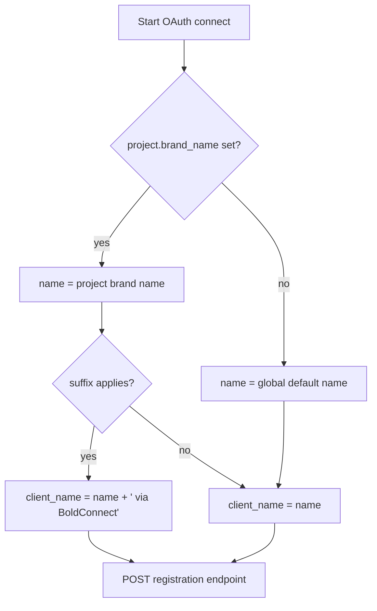

# DCR branding and global OAuth settings

Status: proposed. Needs a decision entry in `docs/architecture/decisions.md` before the migration (new table).

## 1. Goal

| #   | Goal                                                                                                                                                                        |
| --- | --------------------------------------------------------------------------------------------------------------------------------------------------------------------------- |
| 1   | A project can show its own product name on the provider consent screen that DCR produces, instead of "BoldConnect".                                                         |
| 2   | A platform admin sets the global OAuth defaults and rules on a new admin page.                                                                                              |
| 3   | Impersonation stays controlled: the platform decides whether the "via BoldConnect" suffix is mandatory or optional, without the platform storing any customer project list. |

Related: `project-plugins-add-flow.md` §8 and tracker item R2 (`brand_name`). This plan extends them with project-level defaults, extra RFC 7591 fields and the admin page.

## 2. Today

- `prepareOAuth` (`packages/domain/src/mcp/servers.ts`) passes the fixed name `'BoldConnect'` to `registerClient` (`packages/domain/src/mcp/oauth.ts`).
- `registerClient` posts `client_name`, `redirect_uris`, `grant_types`, `response_types` and an auth method that the gateway chooses itself: a public client first, then a secret-holding one if the provider refuses.
- The registered client is stored once on the auth config and reused, so a name change reaches a config only when it registers for the first time.
- The admin app has a global-settings pattern to copy: `LimitsPage`, `admin-limits.ts`, `limit_setting`.

## 3. How the name is chosen



Global settings apply to every project. A project's own branding overrides the global values, field by field. A project has one name, used by every MCP server in the project; there is no per-server name.

| Value                          | Project                                        | Global                  | Fallback      |
| ------------------------------ | ---------------------------------------------- | ----------------------- | ------------- |
| Product name                   | wins                                           | if the project has none | `BoldConnect` |
| Website, privacy policy, terms | wins                                           | if project field empty  | omitted       |
| Blocked names, suffix policy   | no override                                    | always enforced         | none          |
| Show suffix                    | own choice, only when the policy is `optional` | policy                  | on            |

Scope: only projects of kind `platform` can customize. A project of kind `for_you` (`project.kind`) has no branding form and no override; it always registers with the global settings. The branding routes answer 404 for a `for_you` project, and `resolveClientName` ignores any stored project branding when the project kind is `for_you`.

Changing a global default does not change clients that are already registered; a change reaches a config only when that config registers its client for the first time.

Rules:

- The first non-empty value wins: project, then global default.
- The suffix text is global and editable.
- The global suffix policy is `required` or `optional`. `required`: every name carries the suffix. `optional`: each project chooses with a "Show suffix" box (`project.brand_show_suffix`, on by default). There is no per-project list on the admin side, so the platform never sees or stores customer project names or ids in its settings, and the setting works for any number of projects.
- The suffix is added only to a custom project name. A project on platform defaults sends the global name as it is, so it never reads "BoldConnect via BoldConnect".
- The sent name is trimmed, 2 to 60 characters, no control characters, no `http(s)://`, no reserved words from the global block list (for example "Google", "Microsoft", "GitHub").
- The name sent is written to the log with the registration result.

## 3a. Changing branding without reconnecting users

First release (decided): the resolved name is sent only when a config registers its client for the first time. A config that already holds a client is never re-registered, so no stored token is affected and nobody signs in again. Consequence: an already-configured project keeps showing the old name to new users until a later release. There is no Re-register action in the first release.

Later release (deferred, needs its own decision entry): the design below lets already-configured projects pick up a new name. It is not part of the first release, and the `auth_config_client` table and `mcp_oauth_token.auth_config_client_id` column are not created yet.

Refresh today reads the auth config's current client (`access.ts`). Replacing that client would break every stored refresh token, so a branding change must never replace it in place.

- A provider shows the name only when a user authorizes. Connected users never see it again.
- Each connection keeps the client that issued its tokens (`mcp_oauth_token.auth_config_client_id`). Refresh always uses that client.
- Saving new branding marks the config's current client `outdated`. The next new connection registers a client with the new name; existing connections keep refreshing on the old one. Nobody is forced to reconnect.
- If the provider returned `registration_client_uri` and `registration_access_token` (RFC 7592), the gateway first tries to update `client_name` on the same client. On success the client is not outdated and nothing else happens.
- An old client record is deleted when its last token is gone.
- The UI shows counts ("12 connections on the previous name, 3 on the new") and one action, "Use new name for new connections". There is no Re-register all.

## 4. Data model (one migration, existing migrations untouched)

| Table / column                                     | Type                  | Notes                                                                                                                                                                                       |
| -------------------------------------------------- | --------------------- | ------------------------------------------------------------------------------------------------------------------------------------------------------------------------------------------- |
| `project.brand_name`                               | text null             | Default for all DCR configs of the project.                                                                                                                                                 |
| `project.brand_client_uri`                         | text null             | Product home page, sent as `client_uri`.                                                                                                                                                    |
| `project.brand_policy_uri`                         | text null             | Sent as `policy_uri`.                                                                                                                                                                       |
| `project.brand_tos_uri`                            | text null             | Sent as `tos_uri`.                                                                                                                                                                          |
| `project.brand_show_suffix`                        | boolean, default true | Used only when the global suffix policy is `optional`.                                                                                                                                      |
| `oauth_setting`                                    | singleton row         | Global settings, see below.                                                                                                                                                                 |
| `auth_config_client` (deferred)                    | new table             | One row per registered client of a config: client id, sealed secret, metadata, `client_name`, `status` (`current`, `outdated`), RFC 7592 management uri and sealed access token when given. |
| `mcp_oauth_token.auth_config_client_id` (deferred) | uuid null (reference) | The client that issued the tokens; null means the config's legacy client.                                                                                                                   |

A project that uses platform defaults has all four `brand_*` text columns null. "Custom" means a name is stored.

`oauth_setting` columns: `default_client_name`, `name_suffix`, `suffix_policy` (`required` or `optional`), `blocked_names` (text[]), `default_client_uri`, `default_policy_uri`, `default_tos_uri`, `updated_by`, `updated_at`.

`logo_uri` is out of scope: it needs object storage (see `project-plugins-add-flow.md` §13).

## 5. Project form: "OAuth consent screen"

Location: project Settings, Plugins/Auth area, section "OAuth consent screen". Visible to project admins; read only for other roles. Not shown for a `for_you` project.

The form has two modes. Platform defaults is selected for every project that has never saved anything, so most projects never touch it.

```text
OAuth consent screen
Shown by providers (Linear, Notion, ...) when your users connect an account.

 (•) Use platform defaults
     Name       BoldConnect   <- read only
     Website    https://boldconnect.example
     Privacy    https://boldconnect.example/privacy
     Terms      https://boldconnect.example/terms

 ( ) Use custom details
     Product name *   [ Acme Assistant                       ]   13 / 60
     Website          [                                      ]   placeholder: platform default
     Privacy policy   [                                      ]   placeholder: platform default
     Terms of service [                                      ]   placeholder: platform default
     [x] Add " via BoldConnect" after the name                    (shown when the platform makes it optional)

 Name sent to providers:  Acme Assistant via BoldConnect
 Each provider draws its own consent screen, so this is the name we send,
 not a picture of what the provider shows.

 [ Save ]

 One name for every MCP server in this project. Providers store the name when a
 server first registers. Servers that are already registered keep their name,
 and nobody has to reconnect.
```

How the form behaves:

- Choosing "Use platform defaults" and saving clears the four text columns, so the project follows later platform changes automatically.
- Choosing "Use custom details" shows the fields. Only the product name is required. An empty link falls back to the platform value for that link, shown as the placeholder, so a project can customize the name alone.
- The suffix box appears only when the platform policy is `optional`. When the policy is `required` the line shows as checked and locked with the text "Required by the platform".
- Errors show under the field as the user types, and Save stays disabled while any field is invalid. The server runs the same checks and returns the same messages.
- One pure `validateBranding(input, rules)` function in `packages/contracts` holds the checks, so the form and the route cannot disagree. The route supplies the rules (blocked names, policy) from the global settings; `GET /projects/{id}/branding` returns the same rules so the form can validate without a round trip.

Validation:

| Field                  | Rule                                                                                                     | Message                                                            |
| ---------------------- | -------------------------------------------------------------------------------------------------------- | ------------------------------------------------------------------ |
| Product name           | Required in custom mode. Trimmed, 2 to 60 characters. No control characters, no `http://` or `https://`. | "Use 2 to 60 characters."                                          |
| Product name           | Must not contain a blocked name, any case.                                                               | "This name is reserved."                                           |
| Website, policy, terms | Empty, or an `https://` address with a host, up to 2048 characters.                                      | "Enter an https:// address."                                       |
| Name and suffix        | The name plus the suffix is at most 60 characters when the suffix applies.                               | "The name and the suffix together must be 60 characters or fewer." |
| Mode and suffix        | Custom mode needs a name. A suffix choice other than "on" is ignored when the policy is `required`.      | "Enter a product name."                                            |

Example form data, custom mode (request body for `PUT /projects/{id}/branding`):

```json
{
  "mode": "custom",
  "brandName": "Acme Assistant",
  "clientUri": "https://acme.example/assistant",
  "policyUri": "https://acme.example/privacy",
  "tosUri": "https://acme.example/terms",
  "showSuffix": true
}
```

Custom name only, links inherited from the platform:

```json
{ "mode": "custom", "brandName": "Acme Assistant", "showSuffix": true }
```

Back to platform defaults:

```json
{ "mode": "default" }
```

Returned by `GET /projects/{id}/branding`, so the form can draw its fields and validate without re-implementing the rules:

```json
{
  "mode": "custom",
  "brandName": "Acme Assistant",
  "clientUri": "https://acme.example/assistant",
  "policyUri": null,
  "tosUri": null,
  "showSuffix": true,
  "platform": {
    "name": "BoldConnect",
    "clientUri": "https://boldconnect.example",
    "policyUri": "https://boldconnect.example/privacy",
    "tosUri": "https://boldconnect.example/terms",
    "suffix": " via BoldConnect",
    "suffixPolicy": "optional",
    "blockedNames": ["Google", "Microsoft", "GitHub"]
  },
  "effectiveClientName": "Acme Assistant via BoldConnect"
}
```

Validation errors use the existing `validationFailed` shape:

```json
{
  "error": "validation_failed",
  "fields": [
    { "field": "brandName", "message": "This name is reserved." },
    { "field": "policyUri", "message": "Enter an https:// address." }
  ]
}
```

## 6. Admin page: "OAuth" (global settings)

Location: new item "OAuth" in the admin navigation, next to Limits. Page file `apps/admin/client/src/pages/OAuthPage.tsx`. Follows `.agents/skills/admin-ui-design/` (monochrome, light and dark). Every save writes an audit event with a required reason, like Limits.

The page holds only platform values. It never lists, searches or shows projects, organizations or users: the admin role has no access to project data, and a per-project list would not work for a large number of projects.

```text
OAuth                                                        Last changed 31 Oct 2026 by admin@example.com

Defaults for projects that use platform details
 Default client name *     [ BoldConnect ]                          11 / 60
 Default website           [ https://boldconnect.example ]
 Default privacy policy    [ https://boldconnect.example/privacy ]
 Default terms of service  [ https://boldconnect.example/terms ]

Name rules
 Suffix                    [ via BoldConnect ]                      added after the name
 Suffix policy
   (•) Required   every name carries the suffix
   ( ) Optional   a project can turn it off on its own form
 Blocked names (one per line)
 +--------------------------+
 | Google                   |
 | Microsoft                |
 | GitHub                   |
 +--------------------------+
 A project name that contains one of these is refused.

Example of the default name on a consent screen
 "BoldConnect" wants to access your Linear account.   (illustration only)

Reason for change *          [ Allow customers to show their own name only ]
[ Save ]
```

Example form data (request body for `PUT /admin/oauth-settings`):

```json
{
  "defaultClientName": "BoldConnect",
  "defaultClientUri": "https://boldconnect.example",
  "defaultPolicyUri": "https://boldconnect.example/privacy",
  "defaultTosUri": "https://boldconnect.example/terms",
  "suffixPolicy": "optional",
  "nameSuffix": " via BoldConnect",
  "blockedNames": ["Google", "Microsoft", "GitHub"],
  "reason": "Allow customers to show their own name only"
}
```

Seeded value when the table is empty:

```json
{
  "defaultClientName": "BoldConnect",
  "suffixPolicy": "required",
  "nameSuffix": " via BoldConnect",
  "blockedNames": []
}
```

Validation: the default name follows the same name rules as a project name (2 to 60 characters, no links, no control characters); links are empty or `https://`; the suffix is at most 40 characters; blocked names are trimmed, deduplicated, up to 200 entries of up to 60 characters each; the reason is required, 1 to 500 characters. The default name must not contain a blocked name.

Switching the policy from `required` to `optional` changes nothing for existing projects: their `brand_show_suffix` is already on. Switching back to `required` makes every project send the suffix again at its next registration.

## 7. API

| Method | Path                      | Who            | Purpose                                             |
| ------ | ------------------------- | -------------- | --------------------------------------------------- |
| GET    | `/projects/{id}/branding` | project reader | Stored values plus effective name and suffix rules. |
| PUT    | `/projects/{id}/branding` | project admin  | Save project branding.                              |
| GET    | `/admin/oauth-settings`   | platform admin | Read global settings.                               |
| PUT    | `/admin/oauth-settings`   | platform admin | Save global settings with a reason; audited.        |

Contracts: `packages/contracts/src/v1/project-branding.ts` and `admin-oauth.ts`. OpenAPI JSON regenerates on `pnpm build`.

## 8. Code changes

| Area                                  | Change                                                                                                                                                                 |
| ------------------------------------- | ---------------------------------------------------------------------------------------------------------------------------------------------------------------------- |
| `packages/db`                         | Schema, one generated migration, `pnpm db:check`.                                                                                                                      |
| `packages/domain/src/mcp/oauth.ts`    | `registerClient` takes a `RegistrationMetadata` object (`clientName`, `clientUri`, `policyUri`, `tosUri`) instead of a string. Send the optional fields only when set. |
| `packages/domain/src/mcp/servers.ts`  | `oauthPlanOf` loads project and global settings; new `resolveClientName` pure function; `prepareOAuth` uses it.                                                        |
| `packages/domain/src/oauth-settings/` | `getOAuthSettings`, `putOAuthSettings` (audit, reason), `validateBrandName`.                                                                                           |
| `packages/domain/src/project/`        | `getBranding`, `putBranding` (audit event).                                                                                                                            |
| `apps/api`, `apps/admin`              | Routes above.                                                                                                                                                          |
| `apps/web/client`                     | Branding section with preview.                                                                                                                                         |
| `apps/admin/client`                   | `OAuthPage`, navigation item, API client.                                                                                                                              |
| Docs                                  | `decisions.md` entry, `docs/guides/integration.md` note, update tracker R2.                                                                                            |

## 9. Delivery order

| #   | Slice                            | Done when                                                                                   |
| --- | -------------------------------- | ------------------------------------------------------------------------------------------- |
| 1   | Decision entry and migration     | `db:check` and `db:lint` pass; defaults reproduce today's name.                             |
| 2   | Name resolution and registration | `resolveClientName` unit tests pass; provider receives the resolved name and optional URIs. |
| 3   | Admin OAuth page and API         | Settings save with a reason, audited; invalid input rejected.                               |
| 4   | Project branding form            | The shown name matches the effective name from the API; role gating works.                  |

## 10. Tests

Unit (`packages/domain`):

| Case                                               | Expected `client_name`                         |
| -------------------------------------------------- | ---------------------------------------------- |
| Nothing set (platform defaults)                    | `BoldConnect`                                  |
| Project name `Acme Assistant`, suffix required     | `Acme Assistant via BoldConnect`               |
| Policy `optional`, project turns the suffix off    | `Acme Assistant`                               |
| Policy `required`, project has the suffix off      | `Acme Assistant via BoldConnect` (policy wins) |
| Platform defaults mode, any policy                 | `BoldConnect`, no suffix                       |
| Custom name with empty links                       | platform links used                            |
| Blocked name `google`, any case                    | rejected                                       |
| 1 character, 61 characters, URL, control character | rejected                                       |
| Optional URIs missing                              | fields omitted from the request                |
| Non https URI                                      | rejected                                       |
| Config already holds a client                      | never re-registered, name unchanged            |
| `for_you` project with stored branding             | global name, stored branding ignored           |

Also: `registerClient` request body snapshot with and without URIs; settings write without a reason is rejected; every write creates one audit event.

Client (`apps/web/client`, `apps/admin/client`): form renders stored values, preview updates as the user types, validation messages shown, read-only role hides Save, admin page saves with reason. Tests must be console-clean and use `prefetchQuery` with `staleTime: Infinity`.

Integration (`tests/integration`): mock provider registration endpoint receives the resolved name; a config that already has a client is not registered again and its refresh still works after the name changes.

Gate: `pnpm format`, then `pnpm test -- --only=format,lint,typecheck,unit,client` per slice, full `pnpm test` before release.

## 11. Risks and open points

| Risk or question                                           | Handling                                                                                                                |
| ---------------------------------------------------------- | ----------------------------------------------------------------------------------------------------------------------- |
| A project impersonates another company on a consent screen | Suffix policy, blocked names, audit of every change. No per-project list is kept.                                       |
| Renaming forces every user to reconnect                    | It does not: registered configs are never re-registered. They keep the old name until a later release.                  |
| Some providers ignore or cache `client_name`               | The form shows the exact `client_name` that will be sent (not the provider's screen); the log records what was sent.    |
| Logo on the consent screen                                 | Deferred until object storage is decided.                                                                               |
| Default suffix policy                                      | Seeded `required`, the safer choice; an admin switches it to `optional` when customers should show only their own name. |
