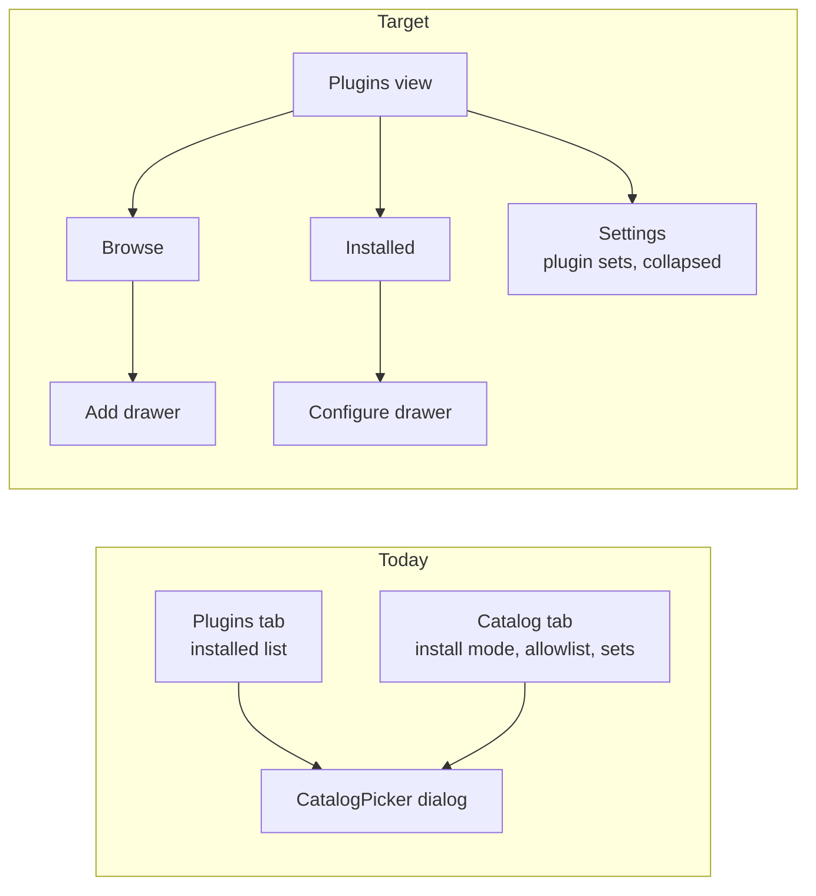
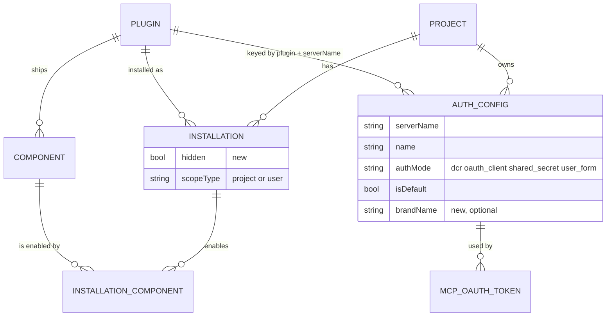
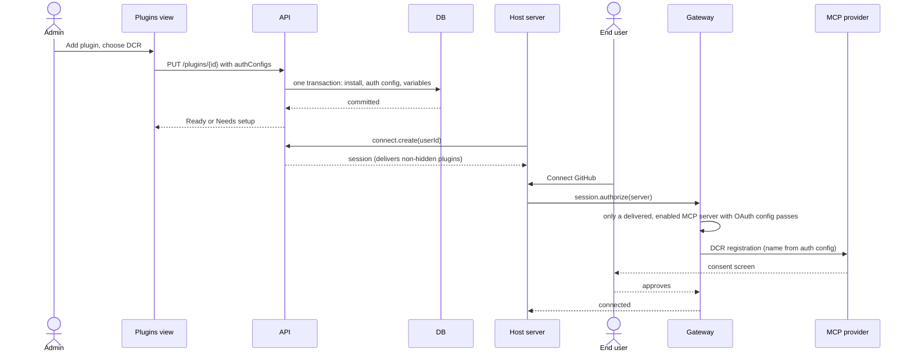
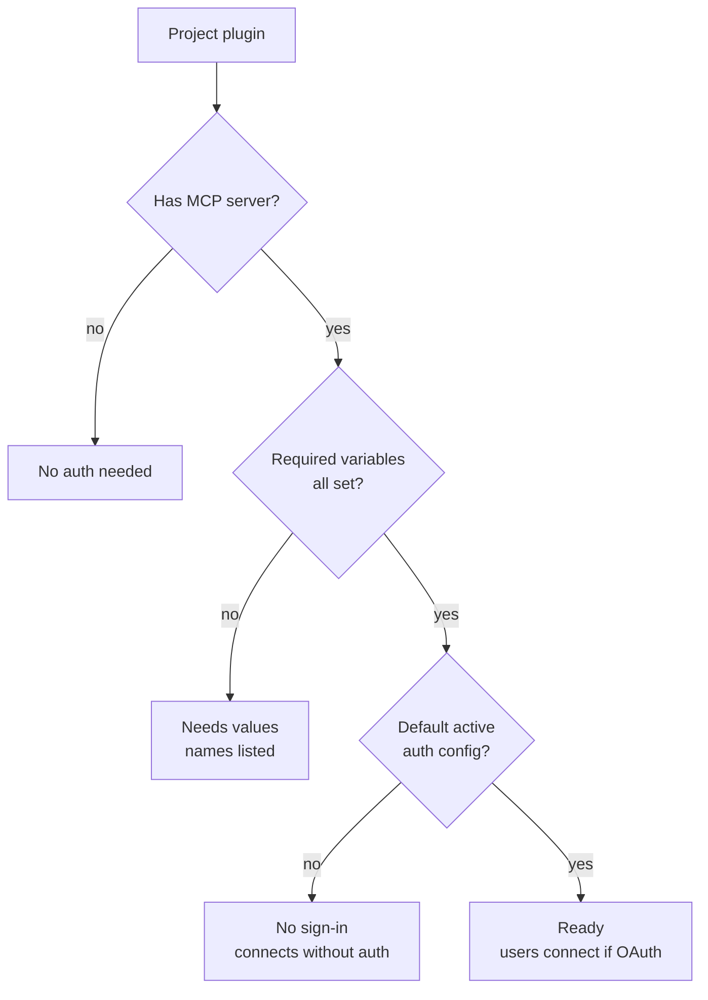
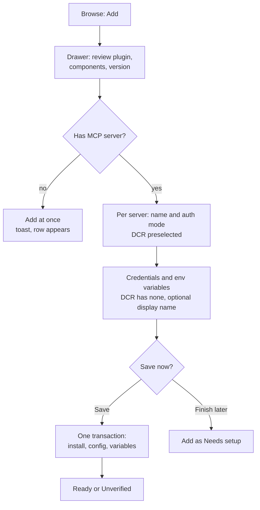
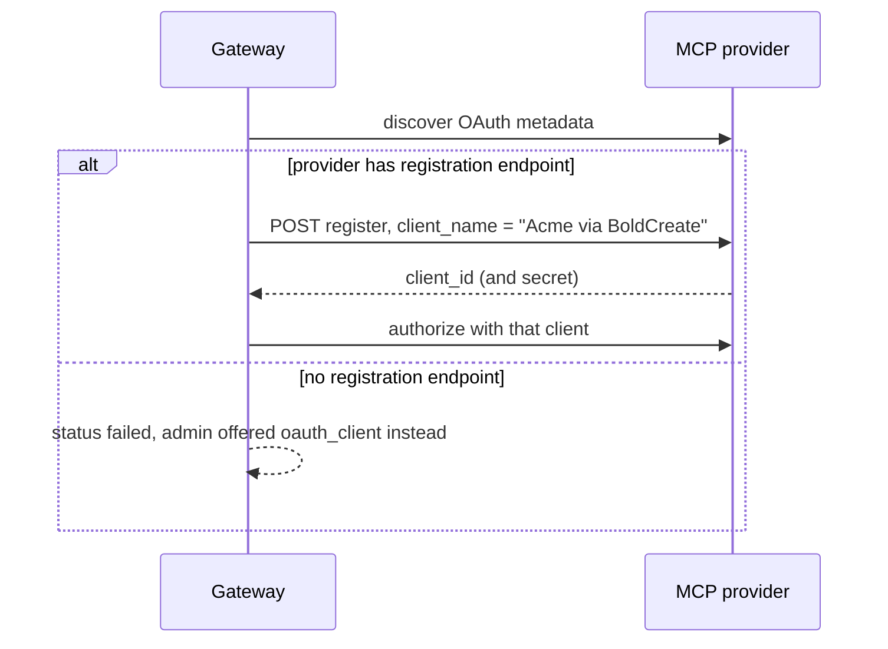
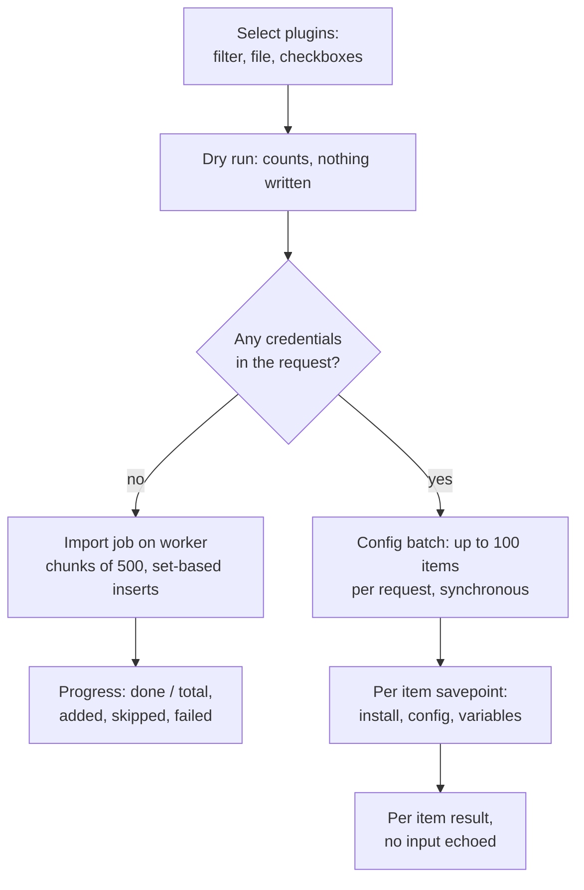
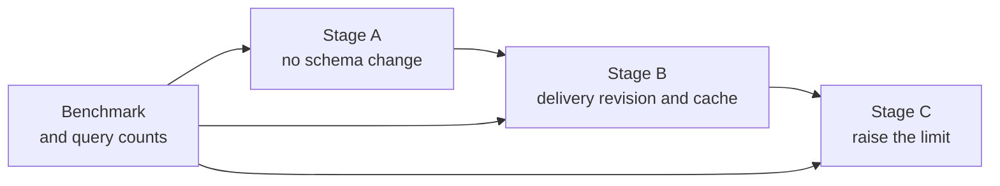

# Project plugins: one view, guided add, DCR and bulk add

Status: **proposed, awaiting approval**. No code has changed.

## 1. What we are building

An admin of a host project should be able to pick plugins from a catalog of thousands, configure their MCP sign-in in the same step, add hundreds at once, and hide a plugin without losing its setup. The host's end users then receive those plugins automatically and only connect (OAuth) the ones that need it.

| #   | Outcome                                                                              |
| --- | ------------------------------------------------------------------------------------ |
| 1   | One **Plugins** view replaces the Plugins and Catalog tabs.                          |
| 2   | **Add** configures MCP auth (DCR or others) and variables in one atomic save.        |
| 3   | A **Hidden** flag stops a plugin from reaching end users without deleting its setup. |
| 4   | **Bulk add** works for thousands of plugins, with credentials supplied safely.       |
| 5   | **DCR** registers with a project-chosen display name and clear status.               |
| 6   | **Search and paging** stay fast with a catalog of about 15,000 plugins.              |

Out of scope now: managed OAuth, org-level allowlist and tier policy, user self-install. Hooks for them are listed in section 13.

## 2. Decisions

| Decision                     | Result                                                                                        |
| ---------------------------- | --------------------------------------------------------------------------------------------- |
| One view instead of two tabs | Yes. **Installed / Browse** inside one Plugins view.                                          |
| Allowlist                    | Removed from the UI. Backend code stays untouched (it backs the hidden self-install feature). |
| User self-install            | A hidden feature. No UI. Backend stays off. Exposed only if a customer asks.                  |
| Hidden flag                  | Added. Hidden plugins are not delivered to end users. The admin still sees them.              |
| Connect in the admin view    | None. Connecting is an end-user action in the host.                                           |
| OAuth only for installed MCP | Already enforced in code; tests added (section 6).                                            |
| Managed OAuth                | Deferred. Hooks kept.                                                                         |
| Existing projects            | None. Staging only, so no data mapping is needed in migrations.                               |

Assumptions used below until you say otherwise (all easy to change):

| Open point             | Assumed answer                                                                                    |
| ---------------------- | ------------------------------------------------------------------------------------------------- |
| Add UI                 | Right-side drawer.                                                                                |
| Atomic add route       | Extend `PUT .../plugins/{pluginId}` with an optional `authConfigs` body.                          |
| `/catalog` redirect    | None. Staging has no existing links.                                                              |
| Save and finish later  | Allowed. The plugin shows `Needs setup`.                                                          |
| 15k plugins            | The catalog size. The per-project limit starts at about 1,000 and is raised only after measuring. |
| Plugin sets            | Kept in a collapsed "Plugin sets" area of Settings until a check shows nothing consumes them.     |
| Bulk credentials       | CLI or SDK import, secrets from the environment. UI grid takes secrets for small batches only.    |
| Bulk "Set up with DCR" | Applies to every MCP server of the selection, shown as `Unverified` until a check confirms it.    |

## 3. Today and target



Why the split goes: both tabs pick plugins through the same dialog, and "Catalog" names a data source while the tab holds install policy that your hosts never use.

### Plugins view layout

```text
+--------------------------------------------------------------------------+
| Plugins                              [ Bulk add ]  [ Add plugin ]        |
| ( Installed 42 )  ( Browse )                              [ Settings ]   |
+--------------------------------------------------------------------------+
| Search...   Status: All v   Kind: All v        [x] Show hidden           |
+--------------------------------------------------------------------------+
| Plugin          Version   Status        Auth      Updated    Actions     |
| GitHub          1.4.0     Ready         OAuth     2d ago     Configure.. |
| Linear          2.0.1     Ready         DCR       1h ago     Configure.. |
| Postgres MCP    0.9.0     Needs values  Secret    5m ago     Configure.. |
| Code Style      1.0.0     No auth       -         1w ago     Configure.. |
| Old Tool        0.3.0     No sign-in    -         3w ago     Configure.. |
+--------------------------------------------------------------------------+
| Needs values (1)  >                                                      |
+--------------------------------------------------------------------------+
```

Browse uses the same row component. Rows already in the project show their status instead of an Add button. There is no Connect button anywhere in this view.

## 4. How the pieces fit

### Data model

An auth config belongs to one MCP **server** of a plugin, not to the plugin. It survives removing the plugin, and it applies to every install of that plugin in the project.



Rules checked in `packages/db/src/schema/mcp.ts`:

- Key is `(project, plugin, serverName, name)`. A server may have several configs and exactly one default (`auth_config_one_default_idx`). The first config becomes the default.
- A plugin with several MCP components needs one config per server.
- Variables belong to the installation and are written through the existing variables path, not on the config.
- Secrets are sealed with the config id. They are write-only, with only the last four characters shown.

### End to end



## 5. Status of a plugin

Status is derived, never stored, and it follows what the user-facing state already computes (`allStates` in `packages/domain/src/project/user-plugin-state.ts`): required variables with no value make a server not ready, and an MCP server **without** an auth config is treated as needing no sign-in.



Chips: `Ready`, `Needs values`, `No sign-in`, `No auth needed`. Delivery 2 adds `Hidden` and delivery 3 adds `Unverified`.

`No sign-in` is informational. The system cannot know that a server needs auth until an admin or discovery says so, so the add drawer asks per MCP server and offers "No sign-in needed" as a choice (no config is created).

## 6. Host rules

- **Delivery is automatic.** The host calls `connect.plugins.add(pluginId)` once. Each user session then receives every non-hidden project plugin. There is no install step for users.
- **Hidden is not delivered.** Every delivery path calls `effectiveInstallations` through `resolveDelivery` (sync, archive, `session.mcp()`, the gateway's tool calls through `loadVisibleServers`, OAuth start, and the user plugin state). One added condition there covers all of them. Side effect: `users.plugins(userId)` also stops listing a hidden plugin; this is accepted.
- **Only delivered MCP servers can start OAuth.** `plan` in `packages/domain/src/project/connections.ts` already requires a delivered, enabled MCP component whose resolved auth config is `dcr` or `oauth_client`; otherwise `not_found` or `not_oauth`.
- **The host connect state already exists.** `/v1/project/user-plugins` returns, per MCP server, `authMode`, `setup`, `ready` and `connection` (`packages/contracts/src/v1/user-plugin-state.ts`). No new descriptor is added. The host reads it like this:

| `setup.kind`          | Meaning                                              | Host does                                 |
| --------------------- | ---------------------------------------------------- | ----------------------------------------- |
| `none`                | Usable now (`ready: true`)                           | Nothing                                   |
| `connect`             | OAuth server and the user has no active sign-in      | `session.authorize`, then wait for return |
| `variables` (names)   | Required project values are missing                  | "Ask a project admin to finish setup"     |
| `auth_config_missing` | The session names an auth config that does not exist | Fix the session or the config (host-side) |

`user_form` is not offered yet (`AuthConfigInputModeSchema` allows only `dcr`, `oauth_client`, `shared_secret`), so no `user_form` path is built.

## 7. Add flow



Atomic save, in one outer transaction:

1. `putProjectPlugin` (creates the installation and its components).
2. For each MCP server, `createAuthConfig` with that server's `componentId`. The first config becomes the default.
3. Write variables through the existing variables path.

If the plugin is already installed, the call returns the existing state. A config of the same name for a server that already has it is left untouched and reported, so a repeat never changes a stored secret; changing a config uses the auth config routes. Everything commits together or not at all.

## 8. DCR

Today `registerClient` (`packages/domain/src/mcp/oauth.ts`) sends a fixed `client_name` of "BoldCreate Integrations" (`servers.ts:624`). Registration retries a public client, then a secret-holding one.



Changes:

- Optional `brandName` on the auth config, sent as `client_name`. It defaults to the project name and is always suffixed "via BoldCreate" so a project cannot pose as another company on a provider's consent screen.
- Config status in the UI: `registered`, `not registered`, `failed (reason)`. The refusal reason is already reported by the rejection callback; it is surfaced instead of only logged.
- A provider with no registration endpoint offers `oauth_client` (the project's own OAuth app) at add time, not a failure at Connect time.
- Logo (`logo_uri`) is deferred: it needs storage, which is a new dependency (section 13).
- **Verified in `servers.ts` (`oauthPlanOf`, `startAuthorization`):** the client is registered once, at the first connection, and stored on the auth config (`oauth_client_id`, a sealed secret and `oauth_metadata`). Later connections reuse it. So the display name is applied only at that first registration. Changing it later needs an explicit **Re-register** action that clears the stored client; tokens issued to the old client then stop refreshing and every user reconnects. The UI warns before it runs. The status `registered` means the stored client id is present.

## 9. Bulk add

Two lanes, split by whether the request carries secrets. Secrets never enter a job queue because a queued job stores its payload.



**Lane A: credential-free import job** (`POST .../plugin-imports`, then `GET .../plugin-imports/{importId}`)

- Body: `{ source, version: latest | pinned, configure: none | dcr, dryRun }`. Source is a filter, a CSV or JSON of ids or names, or checkbox ids.
- Dry run reports matched, unknown, already added, over the limit, and how many will be `Ready`, `Unverified` and `Needs setup`.
- Set-based writes in chunks of about 500: one `INSERT ... ON CONFLICT DO NOTHING` for installations, one `INSERT ... SELECT` for components, one multi-row insert for DCR default configs, one summary audit event.
- Idempotent and resumable by import id. Safe to cancel. One project lock per job with short chunk transactions. The limit is checked once up front and again per chunk.
- Bulk remove, hide and version change use the same mechanism.

**Lane B: configs with credentials** (`POST .../plugin-config-batches`)

- Each item is `{ plugin, server?, version?, authConfig, variables? }`, the same shape as a single add. Up to 100 items per request.
- Each item commits in its own savepoint. One bad item never rolls back the rest. Results list `created`, `updated`, `skipped`, `failed` with the reason.
- Items are sorted by `(plugin, server)` before running, so the per-server advisory lock (`lockServer`) is always taken in one order and concurrent runs cannot deadlock.
- Secrets are sealed per config id, so these are inserted item by item, not as one multi-row insert.
- Idempotent by `(project, plugin, server, name)`. A changed secret updates the sealed value, which also covers rotation.

**Where secrets come from**

- The CLI or SDK `import` command reads a manifest of names, modes and non-secret fields. Secrets come from the environment or a secret store, with a naming rule such as `BOLD_<PLUGIN>_<FIELD>`. The manifest can be committed.
- Secrets travel only in request bodies over TLS, are sealed on arrival and pass through `redactSecrets` in logs, errors and results. Audit records actor, plugin and mode, never values.
- Dry run validates every item and flags missing secret references. It cannot tell whether a secret is correct. An optional verify step per config can report wrong secrets after apply.
- The UI grid accepts secrets for small batches only (about 50), keeps them in memory and never saves them. Larger imports point to the CLI.

**Per-project limit.** `PROJECT_LIMITS.pluginsPerProject` is 100 today (`packages/limits/src/numbers.ts`). It starts at about 1,000 and is raised only after the host sync path is confirmed to page and measured.

## 10. Search at 15,000 plugins

`listPluginsWhere` (`packages/domain/src/marketplace/plugins.ts`) uses `ilike '%term%'` on three columns, `count(*)` on every request, `EXISTS` subqueries for kind and category, and page numbers. That suits dozens of plugins, not 15,000.

| Change                                                      | Why                                                       |
| ----------------------------------------------------------- | --------------------------------------------------------- |
| Trigram (or full-text) index on name, display name, summary | `ilike` with a leading wildcard cannot use a normal index |
| Cursor (keyset) paging in Browse                            | Stable and fast at any depth, like `listProjectPlugins`   |
| Cached or approximate total                                 | Avoids `count(*)` on each request                         |
| Virtualised list and debounced search                       | Smooth scrolling and fewer requests                       |

Target: first results in about 300 ms. This is a goal. Measure before and after on a 15,000-row dataset.

## Loading thousands of plugins without issues

Nothing below has been measured. The costs come from reading the code; the first work item is a benchmark that proves or disproves each one.

### Where the cost sits today

| #   | Path                                       | What it does now                                                                                                                         | Why it hurts at thousands                                                                  | Fix                                                                                                                         |
| --- | ------------------------------------------ | ---------------------------------------------------------------------------------------------------------------------------------------- | ------------------------------------------------------------------------------------------ | --------------------------------------------------------------------------------------------------------------------------- |
| 1   | Gateway tool call (`loadVisibleServers`)   | Loads every effective installation and every MCP component **with its tool list (jsonb)**, then applies the `only` server filter in code | Each single tool call costs the same as listing everything                                 | Name the servers from a query without `tools`, then fetch the tools of the one matched server                               |
| 2   | Tool listing (`listAllTools`)              | Discovers every server that has no stored tool list, all at once with `Promise.all`                                                      | A first listing can open as many upstream calls as there are servers                       | Cap concurrency, discover in the background (worker), report `discovering` instead of waiting, keep the per-server endpoint |
| 3   | Sync (`buildSync`)                         | Every poll loads all installs, all their components (with `metadata` jsonb), runs the 8-query `allStates`, then hashes the result        | Server work grows with plugin count on every poll of every user, even when nothing changed | Per-project delivery revision, `If-None-Match` answers 304 without building; cache the shared project part by revision      |
| 4   | Installation id lists                      | About ten queries pass `inArray(installationId, [every id])`                                                                             | N bind parameters per statement (PostgreSQL allows 65,535), poor plans                     | Join on the installation predicates, or one `= ANY($1::uuid[])` array parameter                                             |
| 5   | Admin auth config list (`listAuthConfigs`) | Reads every config of the project, cuts the page in code, and runs 3 queries per config for its variables                                | Cost grows with all configs, and a page runs about 3 queries per row                       | Keyset paging in SQL; read variable status for the whole page in two queries                                                |
| 6   | Browse (`listPluginsWhere`)                | `ilike '%term%'`, `count(*)` per request, page numbers                                                                                   | Sequential scan, deep pages slow                                                           | Trigram index, cursor paging, cached total (section 10)                                                                     |
| 7   | Add one plugin (`putProjectPlugin`)        | About ten queries per plugin                                                                                                             | 15,000 plugins means about 150,000 queries                                                 | Set-based import job (section 9)                                                                                            |
| 8   | Name assignment and `pickEffective`        | Sorts and de-duplicates in memory                                                                                                        | Fine up to tens of thousands of rows                                                       | Keep                                                                                                                        |

Indexes checked: `installation_project_idx`, the partial unique indexes per scope, `installation_component` primary key, `component` unique on version, kind and name, and the auth config unique key all fit these queries. No missing index was found by reading; `EXPLAIN` on real data decides.

### Rollout in three stages



- **Benchmark first.** A seed script builds a project with 1,000, 5,000 and 15,000 installs (several components each, a share of them MCP) and reports time, query count and rows read for `buildSync`, `loadVisibleServers`, `allStates`, `listProjectPlugins`, `listAuthConfigs` and `listPluginsWhere`. Tests assert **query counts and bind-parameter counts**, which are stable in CI, not wall-clock time.
- **Stage A, safe and no schema change.** Items 1, 2, 4 and 5 above. Each is a local change inside one function with the existing tests as a safety net.
- **Stage B, delivery revision.** A per-project counter bumped in the same transaction as every write that changes what a user receives: install, remove, version change, hidden, component enable, auth config create, update or delete, and variable writes. Sync and the session server list answer `If-None-Match` with 304 in one query. The shared project part is cached by revision and each user adds only their own overlay (component preferences and connections). **Risk:** a write path that forgets to bump leaves stale data. Mitigation: bump inside the shared helpers (`replaceComponents`, `writeVariables`, config functions), a test per write site, and a short maximum cache age as a backstop. Plugin version changes that affect many projects (yank, execution block) must also invalidate; they are included in the cache key.
- **Stage C, raise the per-project limit** only to what the benchmark supports, with the host reads paged where they are not yet.

### Targets (goals, not results)

| Measure                            | Goal                                                    |
| ---------------------------------- | ------------------------------------------------------- |
| Queries for one gateway tool call  | A fixed small number, independent of plugin count       |
| Bind parameters in any statement   | At most 1,000                                           |
| Sync poll when nothing changed     | One query and a 304                                     |
| First tool listing                 | Bounded upstream concurrency, never one call per server |
| Admin plugin and auth config pages | Queries per page independent of total rows              |

### The agent side

A key that sees 1,000 MCP servers also exposes every tool of every server in one listing, which is too much for an agent to use. The existing per-server endpoint (`/{server}/mcp`) and the `plugins` filter on sync let a host hand each agent only the plugins it needs. The plan keeps that and recommends hosts use it. A separate "search tools" feature is out of scope.

## 11. API and data changes

| Change                                                                                                                                                         | Where                                             |
| -------------------------------------------------------------------------------------------------------------------------------------------------------------- | ------------------------------------------------- |
| `PUT .../plugins/{pluginId}` accepts `hidden?`, `authConfigs?`                                                                                                 | contracts, domain, console and host twins         |
| Admin plugin list returns `setup` (status) and `servers[]`; hidden is added in delivery 2. The host connect state already exists in `/v1/project/user-plugins` | contracts, domain, SDK types                      |
| `POST .../plugin-imports`, `GET .../plugin-imports/{importId}`                                                                                                 | contracts, domain, worker, console and host twins |
| `POST .../plugin-config-batches`                                                                                                                               | contracts, domain, console and host twins         |
| Delivery (`resolveDelivery`, sync, `session.mcp()`) skips hidden installs                                                                                      | domain                                            |
| Migration: `installation.hidden`, `auth_config.brand_name`                                                                                                     | `packages/db/migrations` (new file only)          |
| Search index and cursor query for Browse                                                                                                                       | migration and domain                              |
| `DEFAULT_PROJECT_SETTINGS.userInstallMode` becomes `off`                                                                                                       | `packages/limits/src/project-defaults.ts`         |

Every console route has a host twin, kept in step by `routes.parity.test.ts`. Regenerate `docs/openapi/*.json` after contract changes. Record in `docs/architecture/decisions.md`: branding metadata sent to providers, and the new project plugin limit.

## 12. Delivery order

The first priority is the merged Plugins view with add and auth config in one save. Hidden follows it. The step-by-step work, files and tests for each delivery are in [project-plugins-tracker.md](./project-plugins-tracker.md), which supersedes this table. Today three tabs touch plugins (`plugins`, `auth-configs` and `catalog`), and the web client cannot create an auth config at all, so delivery 1 merges all three.

| #   | Delivery                             | Main work                                                                                                                                                   | Done when                                                                                            |
| --- | ------------------------------------ | ----------------------------------------------------------------------------------------------------------------------------------------------------------- | ---------------------------------------------------------------------------------------------------- |
| 1   | One view, add with config            | Merge Plugins, Auth configs and Catalog tabs; Installed and Browse; Add drawer; atomic `authConfigs` on the PUT; status chips; fix the install mode default | MCP plugin adds with DCR or a secret in one save; a failed save leaves nothing; old tabs are gone    |
| 2   | Hidden flag                          | `hidden` column, delivery filter, Hide and Unhide                                                                                                           | Hidden plugins leave `session.mcp()` and sync; unhide restores setup                                 |
| 3   | DCR name and status                  | `brand_name`, registration status, `Unverified`                                                                                                             | Provider refusal reason shown; name sent with the suffix                                             |
| 4   | Search, paging and delivery at scale | Benchmark; Stage A query fixes; index, cursor Browse, cached total; Stage B delivery revision; set the limit from measurement                               | Measured results on 1,000, 5,000 and 15,000 plugins; query counts asserted in tests; host reads page |
| 5   | Bulk add without credentials         | Dry run; import job; DCR defaults                                                                                                                           | 15,000 plugins import in a measured, bounded time; a re-run adds nothing                             |
| 6   | Bulk with credentials                | Config batch route; CLI or SDK import; UI grid for small batches                                                                                            | 500 configs apply from one manifest; no secret in logs, errors or results                            |
| 7   | Branding logo                        | Worker write path to the object store, public serve route, `logo_uri` in DCR; needs a decision on public access                                             | Logo served over HTTPS and sent at registration                                                      |

## 13. Tests and requirements

Tests, in the project the code belongs to:

- Add paths: no MCP, DCR, each other mode, several MCP servers in one plugin, failure with rollback, retry, plugin already installed.
- Hidden: leaves `session.mcp()`, sync and the host list; unhide restores it with configs and connections intact.
- OAuth guard: a hidden plugin, a removed plugin, another project's plugin, a non-MCP component and a non-OAuth mode are all refused.
- Bulk: dry run counts, 15,000-plugin import, re-run adds nothing, mid-run failure resumes, limit refused, per-item failures isolated, secrets absent from results and logs.
- Permissions: write role required; host twins; extend the IDOR security tests.
- Client tests stay console-clean.

Production requirements:

- Atomic and idempotent writes. Zod validation at the edge with per-mode required fields.
- Secrets sealed, write-only, never logged or returned. Audit events carry no values.
- Accessibility: drawer focus trap, labelled fields, keyboard-only add, status never by colour alone, light and dark per `.agents/skills/admin-ui-design/`.
- States: loading, empty, error with retry, needs setup, read-only for members without write.

## Checked against the source

Two reading passes; file references are in [project-plugins-tracker.md](./project-plugins-tracker.md).

| Assumption in this plan                                    | Result                                                                                                                                                        |
| ---------------------------------------------------------- | ------------------------------------------------------------------------------------------------------------------------------------------------------------- |
| Add and config can share one transaction                   | Confirmed. Both routes run in one tenant transaction and the domain functions use savepoints.                                                                 |
| The add drawer can show env variables before install       | Confirmed. `getVariableSchema` reads declarations from the version, so the plugin detail can carry them.                                                      |
| Host keys are limited to the right scope                   | **Corrected.** The host route checks only `plugins:write`. A PUT that carries configs or variables must also require `auth-configs:write`.                    |
| Idempotency is safe on routes with secrets                 | **Qualified.** Only a hash of the request and the response are stored. Fine for the add; avoid it for the credential batch.                                   |
| One rule can hide a plugin everywhere                      | Confirmed. All delivery paths use `effectiveInstallations`, including the gateway's tool calls.                                                               |
| Plugin sets can be dropped                                 | **Corrected.** Public SDK API; they stay, in Settings.                                                                                                        |
| Only the web client and TypeScript SDK follow the contract | **Corrected.** The .NET SDK wraps the same routes (`AddAsync`) and its contract tests use JSON literals; add the fields there.                                |
| There were two tabs to merge                               | **Corrected.** Three: Plugins, Auth configs, Catalog. The web client cannot create an auth config today.                                                      |
| A new connect descriptor is needed for the host            | **Corrected.** It exists: `mcp[].setup`, `ready`, `authMode`, `connection` in the user plugin state. Reused, not added.                                       |
| "Needs setup" means a missing auth config                  | **Corrected.** A server without a config is treated as no sign-in. Needs values comes from missing required variables.                                        |
| `user_form` is a mode to support                           | **Corrected.** Not offered yet. Only `dcr`, `oauth_client`, `shared_secret` are accepted on create.                                                           |
| Changing the DCR name forces reconnect                     | **Confirmed, with detail.** The registered client is stored on the auth config at first connection and reused. See section 8.                                 |
| Logo storage is a new service                              | **Corrected.** An object store exists (api reads, worker writes). A logo needs a worker write path and a public serve route, and a decision on public access. |
| The host sync path can take thousands of plugins           | **Not true yet.** `effectiveInstallations`, sync and archive load every installation with no paging. The limit stays low until this is measured.              |
| A drawer can reuse the dialog                              | **Partly.** `DialogContent` is centered with its own motion class, so a `sheet.tsx` with its own placement is needed.                                         |

## 14. Risks and checks before building

| Risk or check                                                                                                                                   | Action                                                                        |
| ----------------------------------------------------------------------------------------------------------------------------------------------- | ----------------------------------------------------------------------------- |
| `resolveDelivery` must be able to filter on `hidden` (read its caller, not the function)                                                        | Read it first in delivery 1                                                   |
| Confirmed: delivery, sync and archive load every installation with no paging                                                                    | Measure before raising the limit; page the host reads in delivery 4           |
| Confirmed: only a hash of the request and the response are stored, not the body                                                                 | Avoid idempotency keys on the credential batch, or hash without secret values |
| Confirmed: the registered client lives on the auth config and is reused, so a name change needs an explicit Re-register and all users reconnect | Warn in the UI; section 8                                                     |
| An object store exists (api reads, worker writes), but a logo needs a public serve route                                                        | Decide public access before delivery 7                                        |
| Hiding a plugin with active sessions: keep them or revoke                                                                                       | Decide in delivery 1; recommended: new sessions only                          |
| Plugin sets consumers unknown                                                                                                                   | Search for consumers; remove if none                                          |

Deferred, with hooks kept:

- **Managed OAuth.** Platform-owned apps, shared credentials, quotas and kill switches. Hook: plugin versions get an `authSchemes` list and the auth mode is data the UI reads.
- **Org-level allowlist and tier policy.**
- **Branded Connect page** as a Composio-style alternative to DCR branding.
- **User self-install.** The backend stays, off by default.

## 15. Verification before done

`pnpm format`, then `pnpm test -- --only=format,lint,typecheck,unit,client` per delivery, then the full `pnpm test` with `overall: PASSED` and zero errors and warnings. Anything that cannot run is reported as not run.
