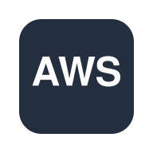
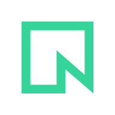
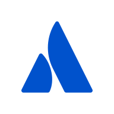
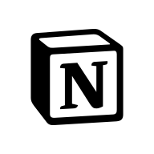

# BoldCreate-Plugins

A plugin marketplace for **BoldCreate Connect**. Each plugin packages a remote MCP server so a team can install it once and every member's agent gets it, with secrets entered at install time.

The same folders install in **Cursor** (`.cursor-plugin/`), **Claude Code** (`.claude-plugin/`) and **BoldCreate Connect** (`.boldcreate-plugin/`). Each of the three has a marketplace index at the repo root and a manifest in every plugin folder.

| Client | Marketplace index | Per-plugin manifest |
| --- | --- | --- |
| BoldCreate Connect | `.boldcreate-plugin/marketplace.json` | `third_party/<name>/.boldcreate-plugin/plugin.json` |
| Cursor | `.cursor-plugin/marketplace.json` | `third_party/<name>/.cursor-plugin/plugin.json` |
| Claude Code | `.claude-plugin/marketplace.json` | `third_party/<name>/.claude-plugin/plugin.json` |

The BoldCreate manifest is self-contained: metadata, each MCP component with its transport and auth type, typed install-time variables with a `secret` flag, rollout phase and wave, and `supportedByGateway`. The BoldCreate marketplace index carries enough per plugin (transports, auth, whether secrets are needed, rollout) for ingestion and the marketplace UI to filter without opening each manifest.

## Phase 1: 15 streamable HTTP plugins

BoldCreate Connect supports only streamable HTTP today, so every Phase 1 plugin is a vendor-hosted HTTP server. Test in two waves: **A** needs a token or no auth; **B** needs each member to sign in with OAuth.

| Logo | `name` | Plugin | What it does | Auth | Install-time variables | Wave |
| --- | --- | --- | --- | --- | --- | --- |
|  | `aws-knowledge` | [AWS Knowledge](third_party/aws-knowledge/) | Search AWS documentation, API references, and regional availability. | None | none | A |
|  | `context7` | [Context7](third_party/context7/) | Pull up-to-date, version-specific library docs and code examples into the prompt. | Token (Bearer) | `CONTEXT7_API_KEY` | A |
|  | `deepwiki` | [DeepWiki](third_party/deepwiki/) | Ask questions about any public GitHub repository and read its generated wiki. | None | none | A |
|  | `github` | [GitHub](third_party/github/) | Manage repos, issues, pull requests, and Actions. | Token (Bearer) | `GITHUB_PERSONAL_ACCESS_TOKEN` | A |
|  | `linear` | [Linear](third_party/linear/) | Find, create, and update Linear issues, projects, and cycles. | Token (Bearer) | `LINEAR_API_KEY` | A |
|  | `microsoft-learn` | [Microsoft Learn](third_party/microsoft-learn/) | Search official Microsoft docs and code samples for .NET, Azure, MAUI, and more. | None | none | A |
|  | `neon` | [Neon](third_party/neon/) | Manage Neon serverless Postgres projects, branches, queries, and migrations. | Token (Bearer) | `NEON_API_KEY`, `NEON_READ_ONLY` | A |
|  | `posthog` | [PostHog](third_party/posthog/) | Query product analytics, manage feature flags, and investigate errors in PostHog. | Token (Bearer) | `POSTHOG_API_KEY` | A |
|  | `stripe` | [Stripe](third_party/stripe/) | Work with Stripe customers, payments, subscriptions, and search Stripe docs. | Token (Bearer) | `STRIPE_AGENT_KEY` | A |
|  | `supabase` | [Supabase](third_party/supabase/) | Query Postgres, manage tables, auth, storage, and edge functions in a Supabase project. | Token (Bearer) | `SUPABASE_ACCESS_TOKEN`, `SUPABASE_PROJECT_REF`, `SUPABASE_READ_ONLY` | A |
|  | `atlassian` | [Atlassian (Jira + Confluence)](third_party/atlassian/) | Search and update Jira issues and Confluence pages. | OAuth | none | B |
|  | `figma` | [Figma](third_party/figma/) | Turn Figma frames into code and read design tokens, components, and variables. | OAuth | none | B |
|  | `notion` | [Notion](third_party/notion/) | Search, read, and update Notion pages and databases. | OAuth | none | B |
|  | `sentry` | [Sentry](third_party/sentry/) | Investigate Sentry errors, stack traces, and issues for a project. | OAuth | `SENTRY_ORG`, `SENTRY_PROJECT` | B |
|  | `vercel` | [Vercel](third_party/vercel/) | Inspect Vercel projects, deployments, and build logs, and search Vercel docs. | OAuth | none | B |

Next: [Phase 2 list](docs/phase-2.md) · [Transport catalogue](catalog/transports.md) · [Keeping plugins updated (proposal)](docs/maintenance-proposal.md)

## Layout

Plugins follow the [cursor/plugins](https://github.com/cursor/plugins) layout: vendor integrations live in `third_party/<name>/`, each with `.cursor-plugin/plugin.json`, `mcp.json`, `README.md`, `CHANGELOG.md`, `LICENSE` and `assets/`. We add `.claude-plugin/`, `.boldcreate-plugin/` and `boldcreate.json` beside them.

```
.boldcreate-plugin/marketplace.json  generated: plugin index for BoldCreate Connect
.cursor-plugin/marketplace.json      generated: plugin index for Cursor
.claude-plugin/marketplace.json      generated: plugin index for Claude Code
third_party/<name>/                  same layout as cursor/plugins third_party/
  .cursor-plugin/plugin.json         source: metadata + install-time variables
  mcp.json                           source: endpoint, headers with ${VARIABLES}
  boldcreate.json                    source: transport, auth, phase, wave, docs link
  .boldcreate-plugin/plugin.json     generated from the three source files
  .claude-plugin/plugin.json         generated from the three source files
  assets/logo.svg (or .png)          192x192 logo shown in marketplaces
  README.md  CHANGELOG.md  LICENSE
schemas/                             JSON schemas used by the validator
scripts/build.mjs                    regenerates the generated files
scripts/validate.mjs                 checks every plugin (runs in CI on each PR)
```

## How secrets work

Secrets are never committed. `mcp.json` references them as `${VARIABLE}`, and `plugin.json` declares each one under `variables` (JSON Schema). Values marked `"x-sensitive": true` are secrets.

- **Cursor** asks for `variables` at install and fills `${VARIABLE}`.
- **Claude Code** gets the same list as `userConfig` (secrets with `"sensitive": true`, stored in the OS keychain) and fills `${user_config.VARIABLE}`. `scripts/build.mjs` does this conversion.
- **BoldCreate Connect** reads them from `.boldcreate-plugin/plugin.json` (`variables`, each with `required` and `secret`), asks at install, seals the secrets, and injects them into `${VARIABLE}` at the gateway.

## Adding or changing a plugin

1. Create or edit the source files: `third_party/<name>/.cursor-plugin/plugin.json`, `mcp.json`, `boldcreate.json`, `README.md`, `LICENSE`, and a logo in `assets/` (set `logo` in plugin.json). Never edit generated files by hand.
2. Bump `version` and add a `CHANGELOG.md` entry.
3. Run `npm install` once, then `npm run build` and `npm run validate`.
4. Optional: `claude plugin validate third_party/<name>` for Anthropic's own check.
5. Open a pull request.

## Try it locally

- **Claude Code:** `/plugin marketplace add saravananmadhesh/BoldCreate-Plugins`, then `/plugin install github@boldcreate-plugins`.
- **Cursor:** add this repo as a team marketplace in Cursor's dashboard.

## Status

Endpoints were taken from vendor docs on 2026-10-24. Only AWS Knowledge has had a live check so far. Each endpoint needs a live test with real credentials before publishing (see Wave A / B above).

## Logos

GitHub and PostHog logos are copied from cursor/plugins (MIT). Atlassian, Figma, Linear, Neon, Notion, Sentry, Stripe, Supabase and Vercel use marks from [Simple Icons](https://simpleicons.org) (CC0) in brand colours, on Cursor's padded 192x192 white tile. AWS Knowledge, Microsoft Learn, Context7 and DeepWiki have placeholder tiles until we have their official logos. All brand marks are trademarks of their owners.
