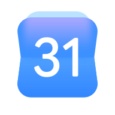
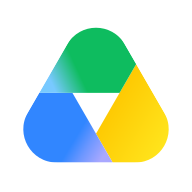
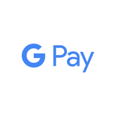
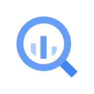
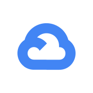
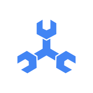
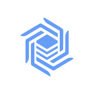

# BoldCreate-Plugins

A plugin marketplace for **BoldCreate Connect**. Each plugin packages a remote MCP server so a team can install it once and every member's agent gets it, with secrets entered at install time.

The same folders install in **Cursor** (`.cursor-plugin/`), **Claude Code** (`.claude-plugin/`) and **BoldCreate Connect** (`.boldcreate-plugin/`). Each of the three has a marketplace index at the repo root and a manifest in every plugin folder.

| Client | Marketplace index | Per-plugin manifest |
| --- | --- | --- |
| BoldCreate Connect | `.boldcreate-plugin/marketplace.json` | `third_party/<name>/.boldcreate-plugin/plugin.json` |
| Cursor | `.cursor-plugin/marketplace.json` | `third_party/<name>/.cursor-plugin/plugin.json` |
| Claude Code | `.claude-plugin/marketplace.json` | `third_party/<name>/.claude-plugin/plugin.json` |

The BoldCreate manifest is self-contained: metadata, each MCP component with its transport and auth type, typed install-time variables with a `secret` flag, rollout phase and wave, and `supportedByGateway`. The BoldCreate marketplace index carries enough per plugin (transports, auth, whether secrets are needed, rollout) for ingestion and the marketplace UI to filter without opening each manifest.

## Phase 1: 15 streamable HTTP plugins

BoldCreate Connect supports only streamable HTTP today, so every Phase 1 plugin is a vendor-hosted HTTP server. Test in two waves: **A** needs a token or no auth; **B** needs each member to sign in with OAuth.

| Logo | `name` | Plugin | What it does | Auth | Install-time variables | Wave |
| --- | --- | --- | --- | --- | --- | --- |
|  | `aws-knowledge` | [AWS Knowledge](third_party/aws-knowledge/) | Search AWS documentation, API references, and regional availability. | None | none | A |
|  | `context7` | [Context7](third_party/context7/) | Pull up-to-date, version-specific library docs and code examples into the prompt. | Token (Bearer) | `CONTEXT7_API_KEY` | A |
|  | `deepwiki` | [DeepWiki](third_party/deepwiki/) | Ask questions about any public GitHub repository and read its generated wiki. | None | none | A |
|  | `github` | [GitHub](third_party/github/) | Manage repos, issues, pull requests, and Actions. | Token (Bearer) | `GITHUB_PERSONAL_ACCESS_TOKEN` | A |
|  | `linear` | [Linear](third_party/linear/) | Find, create, and update Linear issues, projects, and cycles. | Token (Bearer) | `LINEAR_API_KEY` | A |
|  | `microsoft-learn` | [Microsoft Learn](third_party/microsoft-learn/) | Search official Microsoft docs and code samples for .NET, Azure, MAUI, and more. | None | none | A |
|  | `neon` | [Neon](third_party/neon/) | Manage Neon serverless Postgres projects, branches, queries, and migrations. | Token (Bearer) | `NEON_API_KEY`, `NEON_READ_ONLY` | A |
|  | `posthog` | [PostHog](third_party/posthog/) | Query product analytics, manage feature flags, and investigate errors in PostHog. | Token (Bearer) | `POSTHOG_API_KEY` | A |
|  | `stripe` | [Stripe](third_party/stripe/) | Work with Stripe customers, payments, subscriptions, and search Stripe docs. | Token (Bearer) | `STRIPE_AGENT_KEY` | A |
|  | `supabase` | [Supabase](third_party/supabase/) | Query Postgres, manage tables, auth, storage, and edge functions in a Supabase project. | Token (Bearer) | `SUPABASE_ACCESS_TOKEN`, `SUPABASE_PROJECT_REF`, `SUPABASE_READ_ONLY` | A |
|  | `atlassian` | [Atlassian (Jira + Confluence)](third_party/atlassian/) | Search and update Jira issues and Confluence pages. | OAuth | none | B |
|  | `figma` | [Figma](third_party/figma/) | Turn Figma frames into code and read design tokens, components, and variables. | OAuth | none | B |
|  | `notion` | [Notion](third_party/notion/) | Search, read, and update Notion pages and databases. | OAuth | none | B |
|  | `sentry` | [Sentry](third_party/sentry/) | Investigate Sentry errors, stack traces, and issues for a project. | OAuth | `SENTRY_ORG`, `SENTRY_PROJECT` | B |
|  | `vercel` | [Vercel](third_party/vercel/) | Inspect Vercel projects, deployments, and build logs, and search Vercel docs. | OAuth | none | B |

## Next version: Google, GitLab and Gitea (41 plugins)

Phase 2 starts with every Google product that has a hosted HTTP MCP server, plus GitLab and Gitea. Local-only (stdio) servers, such as Google's MCP Toolbox plugins in Claude's catalogue, are left out until BoldCreate Connect supports stdio. None of these endpoints has had a live test yet.

### Google Workspace (10)

Google hosts these at `https://<product>mcp.googleapis.com/mcp/v1`. They are in Google's **Workspace Developer Preview** and need a Google OAuth client from your team (`CLIENT_ID`, `CLIENT_SECRET`).

| Logo | `name` | Plugin | What it does | Auth | Install-time variables | Stage |
| --- | --- | --- | --- | --- | --- | --- |
|  | `gmail` | [Gmail](third_party/gmail/) | Search, read, and draft Gmail messages and threads. | OAuth | `CLIENT_ID`, `CLIENT_SECRET` | Developer Preview |
|  | `google-calendar` | [Google Calendar](third_party/google-calendar/) | List calendars, read events, and check free/busy time. | OAuth | `CLIENT_ID`, `CLIENT_SECRET` | Developer Preview |
|  | `google-drive` | [Google Drive](third_party/google-drive/) | Search, read, and create files in Google Drive. | OAuth | `CLIENT_ID`, `CLIENT_SECRET` | Developer Preview |
|  | `google-docs` | [Google Docs](third_party/google-docs/) | Read, create, and edit Google Docs. | OAuth | `CLIENT_ID`, `CLIENT_SECRET` | Developer Preview |
|  | `google-sheets` | [Google Sheets](third_party/google-sheets/) | Read, create, and update Google Sheets spreadsheets. | OAuth | `CLIENT_ID`, `CLIENT_SECRET` | Developer Preview |
|  | `google-slides` | [Google Slides](third_party/google-slides/) | Read, create, and edit Google Slides presentations. | OAuth | `CLIENT_ID`, `CLIENT_SECRET` | Developer Preview |
|  | `google-chat` | [Google Chat](third_party/google-chat/) | Read Google Chat spaces and messages, and post messages. | OAuth | `CLIENT_ID`, `CLIENT_SECRET` | Developer Preview |
|  | `google-contacts` | [Google Contacts](third_party/google-contacts/) | Look up contacts and people in your Google Workspace directory. | OAuth | `CLIENT_ID`, `CLIENT_SECRET` | Developer Preview |
|  | `google-classroom` | [Google Classroom](third_party/google-classroom/) | Read courses, rosters, and coursework, and post announcements in Google Classroom. | OAuth | `CLIENT_ID`, `CLIENT_SECRET` | Developer Preview |
|  | `google-workspace-search` | [Google Workspace Search](third_party/google-workspace-search/) | Search across Gmail, Drive, Calendar, and other Google Workspace content in one place. | OAuth | `CLIENT_ID`, `CLIENT_SECRET` | Developer Preview |

### Google developer (8)

Google-hosted servers for developer products. Auth varies: an API key header, OAuth, or none.

| Logo | `name` | Plugin | What it does | Auth | Install-time variables | Stage |
| --- | --- | --- | --- | --- | --- | --- |
|  | `google-developer-knowledge` | [Google Developer Knowledge](third_party/google-developer-knowledge/) | Search official Google developer documentation for Android, Firebase, Google Cloud, and Maps. | API key (header) | `GOOGLE_API_KEY` | GA |
|  | `google-maps-grounding-lite` | [Google Maps Grounding Lite](third_party/google-maps-grounding-lite/) | Ground agents in Google Maps data: places, routes, and weather. | API key (header) | `GOOGLE_MAPS_API_KEY` | GA |
|  | `google-maps-code-assist` | [Google Maps Code Assist](third_party/google-maps-code-assist/) | Get up-to-date Google Maps Platform docs and code samples while you write Maps code. | None | none | Preview |
|  | `google-stitch` | [Stitch](third_party/google-stitch/) | Generate UI designs and front-end code with Google Stitch. | API key (header) | `STITCH_API_KEY` | Beta |
|  | `google-design` | [Google Design](third_party/google-design/) | Get Google design guidance and assets, such as Material Design, while you build UI. | None | none | Preview |
|  | `firebase-sql-connect` | [Firebase SQL Connect](third_party/firebase-sql-connect/) | Work with Firebase SQL Connect (Data Connect) services, schemas, and queries. | OAuth | `CLIENT_ID`, `CLIENT_SECRET` | Preview |
|  | `android-management` | [Android Management](third_party/android-management/) | Manage enterprise Android devices, policies, and apps with the Android Management API. | OAuth | `CLIENT_ID`, `CLIENT_SECRET` | GA |
|  | `google-pay-wallet` | [Google Pay and Wallet](third_party/google-pay-wallet/) | Manage Google Pay merchant setup and read Google Wallet issuer data. | OAuth | `CLIENT_ID`, `CLIENT_SECRET` | Preview |

### Google Cloud (21)

Google hosts these at `https://<service>.googleapis.com/mcp`. Each uses Google OAuth with a client from your team (`CLIENT_ID`, `CLIENT_SECRET`, the same pattern as Cursor's BigQuery plugin) and the IAM roles of whoever signs in. About 50 more Google Cloud servers can be added on demand.

| Logo | `name` | Plugin | What it does | Auth | Install-time variables | Stage |
| --- | --- | --- | --- | --- | --- | --- |
|  | `google-cloud-bigquery` | [Google Cloud BigQuery](third_party/google-cloud-bigquery/) | Explore datasets and tables and run SQL queries. | OAuth | `CLIENT_ID`, `CLIENT_SECRET` | GA |
|  | `google-cloud-sql` | [Google Cloud SQL](third_party/google-cloud-sql/) | Manage Cloud SQL for MySQL, PostgreSQL, and SQL Server instances and run queries. | OAuth | `CLIENT_ID`, `CLIENT_SECRET` | GA |
|  | `google-cloud-firestore` | [Google Cloud Firestore](third_party/google-cloud-firestore/) | Read and write Firestore documents and collections. | OAuth | `CLIENT_ID`, `CLIENT_SECRET` | GA |
|  | `google-cloud-spanner` | [Google Cloud Spanner](third_party/google-cloud-spanner/) | Manage Spanner instances and databases and run SQL. | OAuth | `CLIENT_ID`, `CLIENT_SECRET` | GA |
|  | `google-cloud-alloydb` | [Google Cloud AlloyDB](third_party/google-cloud-alloydb/) | Manage AlloyDB for PostgreSQL clusters and run queries. | OAuth | `CLIENT_ID`, `CLIENT_SECRET` | GA |
|  | `google-cloud-bigtable` | [Google Cloud Bigtable](third_party/google-cloud-bigtable/) | Manage Bigtable instances, clusters, and tables. | OAuth | `CLIENT_ID`, `CLIENT_SECRET` | GA |
|  | `google-cloud-memorystore` | [Google Cloud Memorystore](third_party/google-cloud-memorystore/) | Manage Memorystore for Redis, Redis Cluster, and Valkey instances. | OAuth | `CLIENT_ID`, `CLIENT_SECRET` | GA |
|  | `google-cloud-run` | [Google Cloud Run](third_party/google-cloud-run/) | Deploy and manage Cloud Run services and jobs. | OAuth | `CLIENT_ID`, `CLIENT_SECRET` | GA |
|  | `google-kubernetes-engine` | [Google Kubernetes Engine](third_party/google-kubernetes-engine/) | Inspect and manage GKE clusters and workloads. | OAuth | `CLIENT_ID`, `CLIENT_SECRET` | GA |
|  | `google-compute-engine` | [Google Compute Engine](third_party/google-compute-engine/) | Manage Compute Engine VMs, disks, and networks. | OAuth | `CLIENT_ID`, `CLIENT_SECRET` | GA |
|  | `google-cloud-storage` | [Google Cloud Storage](third_party/google-cloud-storage/) | List, read, and manage Cloud Storage buckets and objects. | OAuth | `CLIENT_ID`, `CLIENT_SECRET` | GA |
|  | `google-cloud-logging` | [Google Cloud Logging](third_party/google-cloud-logging/) | Query and analyze Cloud Logging log entries. | OAuth | `CLIENT_ID`, `CLIENT_SECRET` | GA |
|  | `google-cloud-monitoring` | [Google Cloud Monitoring](third_party/google-cloud-monitoring/) | Read Cloud Monitoring metrics, alerts, and dashboards. | OAuth | `CLIENT_ID`, `CLIENT_SECRET` | GA |
|  | `google-cloud-trace` | [Google Cloud Trace](third_party/google-cloud-trace/) | Find and read Cloud Trace spans to debug latency. | OAuth | `CLIENT_ID`, `CLIENT_SECRET` | GA |
|  | `google-cloud-error-reporting` | [Google Cloud Error Reporting](third_party/google-cloud-error-reporting/) | Review grouped application errors from Error Reporting. | OAuth | `CLIENT_ID`, `CLIENT_SECRET` | GA |
|  | `google-cloud-pubsub` | [Google Cloud Pub/Sub](third_party/google-cloud-pubsub/) | Manage Pub/Sub topics and subscriptions and publish messages. | OAuth | `CLIENT_ID`, `CLIENT_SECRET` | GA |
|  | `google-cloud-resource-manager` | [Google Cloud Resource Manager](third_party/google-cloud-resource-manager/) | Browse Google Cloud organizations, folders, and projects. | OAuth | `CLIENT_ID`, `CLIENT_SECRET` | GA |
|  | `google-cloud-iam` | [Google Cloud IAM](third_party/google-cloud-iam/) | Review IAM roles, policies, and service accounts. | OAuth | `CLIENT_ID`, `CLIENT_SECRET` | GA |
|  | `google-cloud-agent-platform` | [Gemini Enterprise Agent Platform (Vertex AI)](third_party/google-cloud-agent-platform/) | Generate content, run predictions, and manage models, endpoints, tuning, and evaluation on Vertex AI. | OAuth | `CLIENT_ID`, `CLIENT_SECRET` | GA |
|  | `google-gemini-cloud-assist` | [Gemini Cloud Assist](third_party/google-gemini-cloud-assist/) | Ask Gemini Cloud Assist to design, troubleshoot, and optimize Google Cloud resources. | OAuth | `CLIENT_ID`, `CLIENT_SECRET` | Preview |
|  | `google-cloud-cli` | [Google Cloud CLI](third_party/google-cloud-cli/) | Run gcloud commands through Google's hosted Cloud CLI server. | OAuth | `CLIENT_ID`, `CLIENT_SECRET` | Preview |

### GitLab and Gitea (2)

GitLab is hosted at `https://gitlab.com/api/v4/mcp` (or your self-managed host). Gitea has no hosted endpoint: your team runs `gitea-mcp` in HTTP mode and enters its host.

| Logo | `name` | Plugin | What it does | Auth | Install-time variables | Stage |
| --- | --- | --- | --- | --- | --- | --- |
|  | `gitlab` | [GitLab](third_party/gitlab/) | Work with GitLab projects, issues, merge requests, pipelines, and code search. | OAuth | `GITLAB_HOST` | GA |
|  | `gitea` | [Gitea](third_party/gitea/) | Work with Gitea repositories, issues, pull requests, and releases through your own gitea-mcp server. | Token (Bearer) | `GITEA_MCP_HOST`, `GITEA_ACCESS_TOKEN` | Self-hosted |

Next: [Phase 2 list](docs/phase-2.md) · [Transport catalogue](catalog/transports.md) · [Keeping plugins updated (proposal)](docs/maintenance-proposal.md)

## Layout

Plugins follow the [cursor/plugins](https://github.com/cursor/plugins) layout: vendor integrations live in `third_party/<name>/`, each with `.cursor-plugin/plugin.json`, `mcp.json`, `README.md`, `CHANGELOG.md`, `LICENSE` and `assets/`. We add `.claude-plugin/`, `.boldcreate-plugin/` and `boldcreate.json` beside them.

```
.boldcreate-plugin/marketplace.json  generated: plugin index for BoldCreate Connect
.cursor-plugin/marketplace.json      generated: plugin index for Cursor
.claude-plugin/marketplace.json      generated: plugin index for Claude Code
third_party/<name>/                  same layout as cursor/plugins third_party/
  .cursor-plugin/plugin.json         source: metadata + install-time variables
  mcp.json                           source: endpoint, headers with ${VARIABLES}
  boldcreate.json                    source: transport, auth, phase, wave, docs link
  .boldcreate-plugin/plugin.json     generated from the three source files
  .claude-plugin/plugin.json         generated from the three source files
  assets/logo.svg (or .png)          192x192 logo shown in marketplaces
  README.md  CHANGELOG.md  LICENSE
schemas/                             JSON schemas used by the validator
scripts/build.mjs                    regenerates the generated files
scripts/validate.mjs                 checks every plugin (runs in CI on each PR)
```

## How secrets work

Secrets are never committed. `mcp.json` references them as `${VARIABLE}`, and `plugin.json` declares each one under `variables` (JSON Schema). Values marked `"x-sensitive": true` are secrets.

- **Cursor** asks for `variables` at install and fills `${VARIABLE}`.
- **Claude Code** gets the same list as `userConfig` (secrets with `"sensitive": true`, stored in the OS keychain) and fills `${user_config.VARIABLE}`. `scripts/build.mjs` does this conversion.
- **Google OAuth clients:** Google's servers don't support dynamic client registration, so Google plugins take `CLIENT_ID` and `CLIENT_SECRET` in an `auth` block in `mcp.json` (Cursor's format). The BoldCreate manifest carries them as `auth.oauthClient` with the OAuth `scopes`. Claude Code plugins have no field for a client secret, so the Claude manifest leaves the block out; each Google plugin's README says how to add the client in Claude Code.
- **BoldCreate Connect** reads them from `.boldcreate-plugin/plugin.json` (`variables`, each with `required` and `secret`), asks at install, seals the secrets, and injects them into `${VARIABLE}` at the gateway.

## Adding or changing a plugin

1. Create or edit the source files: `third_party/<name>/.cursor-plugin/plugin.json`, `mcp.json`, `boldcreate.json`, `README.md`, `LICENSE`, and a logo in `assets/` (set `logo` in plugin.json). Never edit generated files by hand.
2. Bump `version` and add a `CHANGELOG.md` entry.
3. Run `npm install` once, then `npm run build` and `npm run validate`.
4. Optional: `claude plugin validate third_party/<name>` for Anthropic's own check.
5. Open a pull request.

## Try it locally

- **Claude Code:** `/plugin marketplace add saravananmadhesh/BoldCreate-Plugins`, then `/plugin install github@boldcreate-plugins`.
- **Cursor:** add this repo as a team marketplace in Cursor's dashboard.

## Status

Phase 1 endpoints were taken from vendor docs on 2026-10-24, and the Google, GitLab and Gitea endpoints on 2026-10-26 (Google's [supported products list](https://docs.cloud.google.com/mcp/supported-products) and [Workspace MCP guide](https://developers.google.com/workspace/guides/configure-mcp-servers)). Only AWS Knowledge has had a live check so far, and GitLab.com answered with an OAuth challenge. Each endpoint needs a live test with real credentials before publishing (see Wave A / B above).

## Logos

GitHub and PostHog logos are copied from cursor/plugins (MIT). Atlassian, Figma, Linear, Neon, Notion, Sentry, Stripe, Supabase and Vercel use marks from [Simple Icons](https://simpleicons.org) (CC0) in brand colours, on Cursor's padded 192x192 white tile. Gmail, Google Calendar, Drive, Docs, Sheets, Slides and BigQuery logos are copied from cursor/plugins. Other Google, GitLab and Gitea plugins use Simple Icons marks (Google Cloud, Gemini, Firebase, Maps, Chat, Classroom, Android, Pay, Spanner, Bigtable, Cloud Storage, Pub/Sub, or the Google "G" where there is no product mark). AWS Knowledge, Microsoft Learn, Context7 and DeepWiki have placeholder tiles until we have their official logos. All brand marks are trademarks of their owners.
